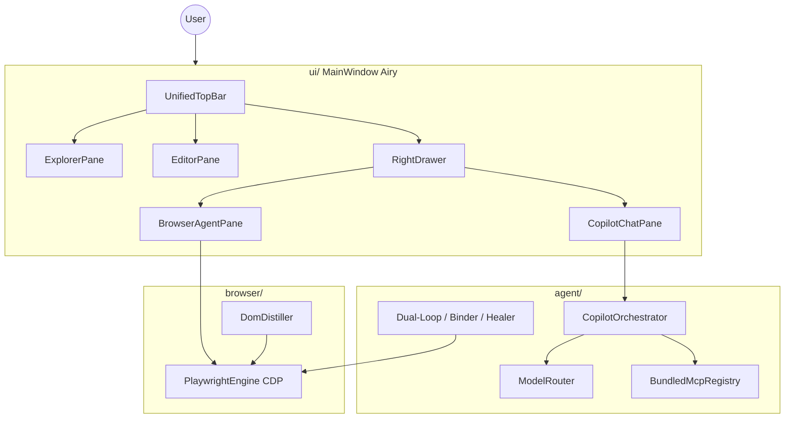

# Architecture — AI QA Test Studio v4.1

## Overview

**AI QA Test Studio** is a Python desktop app for Shift-Left QA automation: author ISO 29119-style cases, bind locators via CDP, run Dual-Loop agents, and collaborate with a **Copilot crew** (Planner → Composer → Critic). The UI is **Airy v4.1**: 2-pane canvas + on-demand right drawer.

Legacy JavaFX (≤3.x) sources are archived under `docs/legacy/javafx/` and are **not** part of the runtime.

---

## Technology stack

| Layer | Technology | Role |
|-------|------------|------|
| Language | Python ≥3.11 | App + agents + reporting |
| Package / tooling | `uv`, `ruff`, `mypy`, `pytest` | Env, lint, types, tests |
| UI | PySide6 + PySide6-Fluent-Widgets + qasync | Desktop shell (`QMainWindow`) |
| Browser | Playwright Python + ephemeral CDP | Launch, screencast, inspect, run |
| LLM | `UnifiedLLMGateway` (OpenAI-compatible / Gemini / …) | All cognitive Copilot steps |
| MCP | In-process bundled servers + optional external | Token tools / Playwright |
| Models | Pydantic v2 | Project / settings / chat session |
| Reports | Jinja2, openpyxl | HTML replay, Excel IEEE 829, Pytest export |

---

## Runtime topology



---

## Package map

```text
ai_qa_test_studio/
├── __main__.py                 # uv run python -m ai_qa_test_studio
├── agent/
│   ├── orchestrator.py         # Crew pipeline + events
│   ├── model_router.py         # task × complexity → model
│   ├── complexity_classifier.py
│   ├── llm_gateway.py
│   ├── bundled_mcp.py
│   └── mcp_servers/            # qa-compress, qa-crew-memory, qa-project-context
├── browser/                    # engine, DOM, inspector, screencast helpers
├── core/                       # models, storage, env_manager, chat_*
├── ui/
│   ├── main_window.py          # shell + breakpoints + wiring
│   ├── theme.py                # Airy QSS tokens
│   └── widgets/
│       ├── top_toolbar.py
│       ├── right_drawer.py
│       ├── chat_pane.py / chat_message_row.py
│       ├── browser_agent_pane.py
│       ├── explorer_pane.py / editor_pane.py
│       ├── system_settings_dialog.py / clarify_dialog.py
│       └── …
└── reporting/                  # CLI-safe exporters (no PySide6)
```

---

## UI shell (ADR 0003)

| Concern | Behavior |
|---------|----------|
| Default | Sidebar + Editor only; drawer **closed** |
| Drawer | Pivot **AI Copilot** \| **Trình duyệt**; width ~340–420 by breakpoint |
| Overlay | Window width `< 960` → drawer overlays canvas |
| Floor | `setMinimumSize(800, 600)`; default `1200×720` |
| Top Bar | Hamburger, Tạo bằng AI, URL, Sync(N), single Primary Chạy/Dừng, Copilot toggle, `⋯` |
| Chat | Context row + Chat\|Wizard; empty **2×2** starters; Copy/Undo on each bubble |
| Busy | Thin `IndeterminateProgressBar` under Top Bar during Sync/Run |

`MainWindow.apply_layout_breakpoint(width)` + `_sync_drawer_geometry()` own responsive layout.

---

## Copilot crew (ADR 0001 / 0002)

1. User prompt → complexity classify → ModelRouter picks model(s).  
2. Planner / Composer / Critic stream via gateway; UI shows **≤160 char** summaries.  
3. Optional bounded debate (≤3) + anti-loop; clarify via non-blocking `ClarifyDialog` + `asyncio.Future`.  
4. `apply_ready` enables Apply (compose drafts / test data).  
5. Stop / Undo (per user message) cancel and trim the turn.

Sessions persist at `{data_root}/copilot/sessions.json`.

---

## Data & settings

- Project: `{data_root}/v4/project.v4.json` (Pydantic `Project`).  
- Config: `{data_root}/config/` — `AppSettings` with `ai.connections[]`, models, routing, MCP flags, Copilot limits.  
- Flat legacy `aiConfig` still migrates on load.

---

## Hard constraints

1. **Reporting must not import PySide6** (CI / headless).  
2. **Single BrowserContext**; CDP endpoint is ephemeral / RAM-oriented.  
3. **No FluentWindow / FramelessWindow**.  
4. **No `QMessageBox` inside `@asyncSlot`** — use InfoBar / ClarifyDialog.show()+Future.  
5. Nav DNS failure → `about:blank` + screencast placeholder.  
6. macOS AX: avoid TreeWidget thrash; use setHidden filter patterns in Explorer.

---

## Related docs

- Binding requirements: [`../SPEC.md`](../SPEC.md)  
- Modules: [`../CAPABILITY_MAP.md`](../CAPABILITY_MAP.md)  
- UI visual SoT: [`Thiết Kế Chi Tiết Giao Diện AI QA Test Studio.md`](Thiết%20Kế%20Chi%20Tiết%20Giao%20Diện%20AI%20QA%20Test%20Studio.md)  
- ADRs: [`adr/`](adr/)
