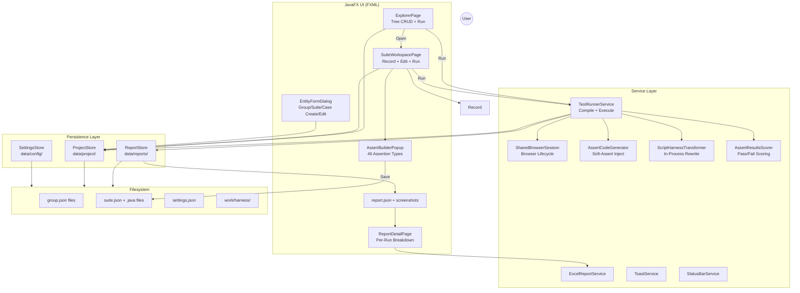

# Architecture

## Overview

**Playwright Automation Studio** is a JavaFX desktop application for managing and running Playwright test automation without writing code manually. Users organize tests in a three-level tree hierarchy (**Group → Suite → Case**), record browser interactions via Playwright codegen, add assertions via a visual builder UI, and run tests with shared browser context. Results are persisted as structured reports with screenshots, exportable to Excel.

The application runs **in-process** — test scripts are compiled and executed within the same JVM using `javax.tools.JavaCompiler` and a `URLClassLoader`, enabling shared browser context across multiple cases.

---

## Technology Stack

| Component | Technology | Version | Purpose |
|-----------|-----------|---------|---------|
| Application Version | Test Studio | 3.0.0 | Desktop automation IDE |
| Language | Java | 26 | Application core, compiler and test scripts |
| UI Framework | JavaFX (FXML) | 26.0.1 | Desktop UI with declarative FXML layouts & Catppuccin theme |
| Browser Automation | Playwright Java | 1.61.0 | Browser launch, page interaction, codegen |
| Embedded Database | H2 Database | 2.2.224 | Dual persistence, in-memory cache & fast queries |
| Document Ingestion | PDFBox & Apache POI | 3.0.4 / 5.5.1 | Multi-format requirement parser (PDF, Word, Excel, PPTX) |
| JSON Serialization | Jackson | 2.18.2 | Serialization of project trees, suites, and reports |
| Build & Tooling | Maven & jpackage | 3.9+ / JDK 26 | Compilation, dependency management, app-image packaging |
| Installer Packaging | Inno Setup & hdiutil | 6.x / macOS | Native Windows Setup (.exe) and macOS (.dmg) installers |
| CI/CD Automation | GitHub Actions | — | Multi-platform build matrix, testing & release delivery |

---

## Package Structure

```
com.studio/
├── App.java                              # JavaFX Application entry point
│
├── model/                                # Data models
│   ├── TestGroup.java                    # Group node (can be nested)
│   ├── TestSuite.java                    # Suite node (contains cases)
│   ├── TestCase.java                     # Individual test case (holds per-case assertions & steps)
│   ├── Assertion.java                    # Assertion definition (type, value, status, 46 types)
│   ├── CaseResult.java                   # Per-case run outcome
│   ├── AssertResult.java                 # Per-assertion run outcome
│   ├── RunReport.java                    # Full run report (all cases)
│   ├── HealedStepMeta.java               # Self-healing audit metadata
│   ├── StepGroup.java                    # Reusable step group model
│   ├── TestDataProfile.java              # Test data matrix & profile model
│   ├── AiAgentRule.java                  # Agent contract: obligations, prohibitions, evidence, dependencies
│   ├── AiSubAgentSession.java            # Per-agent session with real LLM call & token metrics
│   ├── AiModelCapabilities.java          # Per-model output ceiling resolution & clamping
│   └── ChatDisplayMode.java              # COMPACT / SUMMARY / DETAIL transcript rendering
│
├── store/                                # Persistence & Data stores
│   ├── ProjectStore.java                 # Group/Suite/Case CRUD + atomic disk JSON + H2 cache
│   ├── ReportStore.java                  # Run report read/write/delete
│   ├── SettingsStore.java                # User preferences (browser, AI configs, encrypted keys)
│   ├── StepGroupStore.java               # Step group CRUD and persistence
│   ├── TestDataProfileStore.java         # Test data profiles storage
│   └── AiChatHistoryStore.java           # AI chat conversations and prompt histories
│
├── service/                              # Business logic & domain services
│   ├── TestRunnerService.java            # Run orchestration — all 4 scopes, compilation, execution & reconciliation
│   ├── SharedBrowserSession.java         # In-process Playwright browser context lifecycle
│   ├── AssertCodeGenerator.java          # 46 assert types → soft-assert Java code block
│   ├── ScriptHarnessTransformer.java     # Rewrites codegen output with StudioRuntime & healing wrappers
│   ├── ExcelReportService.java           # 3-sheet Excel export (Summary, Cases, Asserts)
│   ├── TestCaseExcelExportService.java   # ISTQB / IEEE test case documentation export
│   ├── HtmlReportService.java            # Standalone single-file HTML report with embedded screenshots
│   ├── AssertResultsScorer.java          # Reads assert-results to determine pass/fail & scores
│   ├── AiTestGeneratorService.java       # Resilient 3-tier parsing & specialist prompt generation
│   ├── AiAgentRuleCatalog.java           # Immutable in-code agent rule catalogue
│   ├── AiCoordinatorAgent.java           # Planner that decomposes requests into rule-bound tasks
│   ├── AiSubAgentOrchestrator.java       # Dependency-wave execution, boundary checks & aggregation
│   ├── AiLlmAgentExecutor.java           # LLM-backed executor for one agent turn
│   ├── AiAgentDefinitionLoader.java      # Loads agent/skill definitions into prompts
│   ├── AiAgentPlanParser.java            # Parses & validates coordinator plans
│   ├── AiStreamAggregator.java           # Thread-safe streamed preview buffers
│   ├── AiChatRunRegistry.java            # In-flight turn registry & cancellation flags
│   ├── AiContinuation.java               # Bounded continuation of truncated replies
│   ├── AiSectionBatches.java             # Heading/line-safe section batching
│   ├── AiCoverageAnalyzer.java           # Traceable coverage & uncovered-screen detection
│   ├── AiDelegationPolicy.java           # Rule selection & delegation limits
│   ├── AiQualityJudge.java               # Output quality scoring
│   ├── UserGuideService.java             # In-app bilingual Markdown user guide reader
│   ├── MarkdownConverterEngine.java      # MarkItDown hybrid document ingestion (PDF, Word, Excel, PPTX, HTML)
│   ├── LiveDomScanner.java               # Active page DOM structure extractor with LRU cache
│   ├── ResourceReleaseService.java       # Operating system heap uncommit & native memory management
│   ├── DataCleanupService.java           # Historical run, screenshot & log storage reclamation
│   ├── ThemeService.java                 # Catppuccin Mocha & Light theme runtime manager
│   ├── I18nService.java                  # Bilingual localization service (Tiếng Việt & English)
│   ├── RunCancelService.java             # Non-blocking hard cancellation coordination
│   ├── RunProgressService.java           # Live progress & step tracker
│   ├── ToastService.java                 # Non-blocking toast notifications
│   └── StatusBarService.java             # Bottom status bar text management
│
├── controller/                           # FXML controllers & view components
│   ├── MainShellController.java          # Shell: sidebar toggle, navigation, toast host, header breadcrumbs
│   ├── ExplorerPageController.java       # Tree CRUD, drag-drop reorder, hover actions, filter chips
│   ├── SuiteWorkspacePageController.java # Code editor, Record/Run, terminal, split view, assert list
│   ├── ReportsPageController.java        # Report history list with scope & status filters
│   ├── ReportDetailPageController.java   # Per-report detail with structured error diagnostics & evidence modal
│   ├── AssertBuilderPopupController.java # Assertion creation/modification modal (46 types)
│   ├── EntityFormDialog.java             # Create/Edit modals for Group, Suite, Case entities
│   ├── AiAssistantPageController.java    # AI chat workspace, prompt presets, document attachments & case import
│   ├── AiCasePromptDialog.java           # Modal dialog for prompt-based test generation & specialist routing
│   ├── LongTextDialog.java               # Scrollable dialog for oversized chat content
│   ├── UserGuideViewerController.java    # Embedded Markdown guide viewer with TOC navigation
│   ├── HelpDrawerController.java         # Collapsible quick help side-drawer
│   ├── TabManager.java                   # Multi-tab document workspace system
│   └── ViewNavigator.java                # Static page navigation + FXML caching
│
├── runtime/                              # In-process runtime, assertions & self-healing engine
│   ├── StudioRuntime.java                # Thread-local Page + BrowserContext + locator healing entry point
│   ├── StudioAssertions.java             # Unified runtime assertions layer with soft-scoring
│   ├── OptimizedSelfHealingExecutor.java # Fast-path locator execution & multi-strategy recovery engine
│   ├── HealedLocatorWrapper.java         # Transparent Playwright Locator proxy with event notifications
│   ├── EnhancedDomExtractor.java         # Deep interactive DOM extractor (Shadow DOM + Iframe traversal)
│   ├── HeuristicHealer.java              # Fast rule-based locator repair (<30ms, dynamic ID, text, role)
│   └── VlmHealer.java                    # Multimodal visual locator fallback for complex UI
│
└── util/                                 # Utilities & Helpers
    ├── StudioPaths.java                  # APP_HOME resolution + directory structure
    ├── BrowserDetector.java              # Cross-platform browser discovery
    ├── StringEscapeUtil.java             # Java string escaping for code generation
    ├── SecuritySanitizer.java            # Sensitive data redaction for logs, toasts, and exceptions
    ├── ApiKeyCipher.java                 # Machine-bound AES-256-GCM encryption for stored API keys
    ├── VariableResolver.java             # Dynamic variable substitution (${url}, ${timestamp})
    ├── CompactScrollBars.java            # 10 px scroll bars that survive VirtualFlow layout
    ├── DialogTheme.java                  # Theme-aware dialog chrome
    ├── SmoothScroll.java                 # Cached eased scrolling for virtualised lists
    ├── UiMotion.java                     # Shared animation & motion helpers
    ├── UiResponsive.java                 # 900/1,280 px breakpoint callbacks
    ├── UiIcons.java                      # Vector SVG icons & graphical helpers
    └── UiTooltips.java                   # Ergonomic UI tooltip helpers
```

---

## Data Flow



---

## Run Flow

```mermaid
sequenceDiagram
    actor User
    participant UI as Explorer/Workspace
    participant Runner as TestRunnerService
    participant Store as ProjectStore
    participant Session as SharedBrowserSession
    participant Compiler as javax.tools.JavaCompiler
    participant Harness as Compiled Harness Class
    
    User->>UI: Click Run (All / Group / Suite / Case)
    UI->>Runner: run(scope, path, headless, browser, stopOnFirst, shareContext)
    
    Runner->>Store: collectCasesForScope(scope, path)
    Store-->>Runner: List&lt;CaseResult&gt; (with SKIPPED pre-marked)
    
    alt shareContext ON and >1 case to run
        Runner->>Session: start(headless, browser)
    end
    
    loop For each case
        alt case.status == SKIPPED
            Note over Runner: Skip — skipReason already set
        else stopOnFirstFailure AND prior failures > 0
            Runner->>Runner: Mark SKIPPED — "Stopped after first failure"
        else
            Runner->>Store: readCaseScript(suiteDir, caseId)
            Store-->>Runner: .java source
            Runner->>Runner: ScriptHarnessTransformer.transform(script)
            Runner->>Runner: AssertCodeGenerator.generateAssertBlock(activeAsserts from case)
            Note over Runner: Inject soft-assert block via brace matching
            Runner->>Runner: Write harness to work/harness/&lt;runId&gt;/
            Runner->>Compiler: compileHarness(harnessFile)
            
            alt Compilation failed
                Runner->>Runner: CaseResult.status = ERROR
            else
                Runner->>Runner: Set StudioRuntime.page for harness
                Runner->>Harness: invoke main() via URLClassLoader
                Harness-->>Runner: Execution completes
                Runner->>Runner: AssertResultsScorer.countFailures(assertResultsFile)
                
                alt any ACTIVE assert FAILED
                    Runner->>Runner: CaseResult.status = FAILED
                else
                    Runner->>Runner: CaseResult.status = PASSED
                end
                Runner->>Runner: Screenshot path assigned (PASSED/FAILED)
            end
        end
    end
    
    alt shareContext ON
        Runner->>Session: close()
    end
    
    Runner->>Store: reportStore.saveReport(report)
    Runner-->>UI: RunReport (with results)
    UI->>User: Toast summary (xP / yF / zS)
    UI->>UI: Navigate to Reports or show results inline
```

---

## Multi-Tier Self-Healing Engine

Playwright Automation Studio integrates an autonomous 5-tier Self-Healing Engine (see full technical specification in [docs/SELF_HEALING_DESIGN.md](file:///Users/tranquoc/Developer/tools/GUI-test-tool/docs/SELF_HEALING_DESIGN.md)). The tiers are implemented by `OptimizedSelfHealingExecutor` (orchestration, per-step retry and mutation budget) together with `HeuristicHealer`, `EnhancedDomExtractor`, `MultiLocatorCascade`, `LocateCache`, `HealedLocatorWrapper`, and `ActionDeltaVerifier`:

1. **Tier 0 (Smart Wait Buffer)**: 350-400ms buffer absorbing hydration delays before declaring failure.
2. **Tier 1 (LocateCache)**: In-memory session cache ensuring sub-millisecond reuse of previously healed selectors across repeated steps.
3. **Tier 2 (Fast Heuristics)**: Zero-cost rule-based browser repair (<30ms) stripping dynamic ID suffixes, hash classes, and mapping semantic attributes (`data-testid`, `aria-label`, placeholder, role with text). Implemented in `HeuristicHealer`, ranked by `MultiLocatorCascade`.
4. **Tier 3 (Multimodal VLM)**: `EnhancedDomExtractor` traverses Shadow DOM & IFrames, paired with compressed JPEG viewport screenshots sent to vision LLM via `OpenAiClient`. Skipped entirely when the configured model is not vision-capable.
5. **Tier 4 (Sandbox Verification)**: Enforces `count == 1 && isVisible() && isEnabled()` before accepting any candidate; `ActionDeltaVerifier` rejects a heal whose action produced no observable page change.
6. **Lazy Dynamic Proxy**: Transformed scripts call `StudioRuntime.healLocator(...)` which delegates via `java.lang.reflect.Proxy`, preserving 100% of native Playwright Auto-Waiting.
7. **Persistent Mutation**: Safely updates quoted string literals in `.java` test scripts and `suite.json` assertions, preventing repeat repair costs in future runs. Mutations are re-read from disk and re-applied to the *current* `suite.json` before saving, and a per-case mutation budget (`resetMutationCounts()` per run) halts anti-thrashing loops.

---

## Local Data Index (H2)

Persistence is **dual**: the filesystem tree above is the source of truth, and an embedded H2 database (`h2` 2.2.224) is a rebuildable index over it for fast search, run history and AI chat recall. Losing or corrupting the index is never data loss — `LocalDataIndexService.syncProjectDirectory` re-indexes from disk, and `ReportStore.listReports` always merges DB rows with a full `report.json` scan.

```
${APP_HOME}/data/studio.mv.db      # jdbc:h2:file:...;AUTO_SERVER=TRUE;DB_CLOSE_DELAY=-1
```

| Table | Contents |
| :--- | :--- |
| `test_groups` | Group path + name/description |
| `test_suites` | Suite identity (`group/name`), browser, headless, absolute path |
| `test_cases` | Case id, name, status, script file, owning suite |
| `test_assertions` | Per-case assertions with order |
| `run_reports` | Run summaries, counts, timestamps |
| `ai_chat_sessions` / `ai_chat_messages` | Chat history + token accounting per suite |
| `system_settings` | Key/value settings mirror |
| `ai_documents_index` / `ai_document_chunks` | Knowledge documents and chunk text for prompt context |
| `ai_exports_index` | Generated export artifacts |

Group identity is the **relative path** from the project root (`ParentGroup/ChildGroup`), never the leaf directory name, so two `Login` groups at different depths cannot collide.

---

## Filesystem Layout

All runtime data lives under `APP_HOME` (resolved by `StudioPaths`):

```
APP_HOME/
├── data/
│   ├── config/
│   │   └── settings.json              # User preferences
│   ├── project/                       # ★ Group → Suite → Case mirror tree
│   │   ├── Smoke/                     # Group folder (has group.json)
│   │   │   ├── group.json
│   │   │   ├── LoginFlow/             # Suite folder (has suite.json)
│   │   │   │   ├── suite.json         # Suite metadata + cases[] with per-case assertions[]
│   │   │   │   ├── LoginValid.java    # Playwright script
│   │   │   │   └── LoginWrong.java
│   │   │   └── HomePage/
│   │   │       ├── suite.json
│   │   │       └── OpenHome.java
│   │   └── Regression/                # Root-level group (or nested)
│   │       └── group.json
│   ├── reports/                       # Run history
│   │   └── 20260725-142301/
│   │       ├── report.json            # RunReport serialized
│   │       └── screenshots/
│   │           ├── LoginValid_PASSED.png
│   │           └── LoginWrong_FAILED.png
│   └── exports/                       # Default Excel export suggestion
├── work/                              # ★ Temporary — safe to delete
│   ├── compile/                       # javac output
│   └── harness/                       # Transformed scripts per run
│       └── 20260725-142301/
│           ├── tc-001_Run.java
│           ├── tc-001_asserts.json
│           └── tc-001_Run.class
```

**Key rules:**

- A folder with `group.json` is a **Group** — it can contain sub-groups and suites.
- A folder with `suite.json` is a **Suite** — it contains test case `.java` files and no sub-folders.
- A folder must not contain both `group.json` and `suite.json`.
- `work/` and `data/reports/` are in `.gitignore`. `data/project/` may be committed as sample data.
- `ProjectStore`, `ReportStore`, and `StudioPaths` always resolve paths through `APP_HOME/data/` — no relative paths mixed into `src/`.

---

## Key Design Decisions

### In-process test execution

Tests run in the **same JVM** as the application. This enables:

- **Shared browser context** — one `BrowserContext` for all cases in a Suite/Group/All run.
- **Session persistence** — cookies, localStorage, and sessions carry across cases (e.g., login once, use for checkout).
- **Soft-assert injection** — assertions are injected as a Java code block and compiled together with the harness.

The `ScriptHarnessTransformer` rewrites codegen output to remove `Playwright.create()` / `launch()` / `close()` calls and replace them with `StudioRuntime.page()` (a `ThreadLocal`).

### Assertion model — per-case

Assertions are defined **per case** within `suite.json` (not per-suite). Each assertion has:

- `type` — one of 46 assertion types across 8 categories
- `value` / `locator` / `attribute` / `expectedValue` / `operator` — assertion parameters
- `status` — `DRAFT` | `ACTIVE` | `INACTIVE`
- `timeoutMs` — default 30,000ms
- `exact` — boolean for exact match mode
- `altContains` — alternative contains text

Only `ACTIVE` assertions are injected and executed. `DRAFT` and `INACTIVE` are skipped.

**Legacy migration**: Suite-level `assertions[]` key still exists on `TestSuite` but is automatically migrated to the first case on load via `migrateLegacyAssertionsToCases()`. New saves always clear the legacy key.

The `AssertCodeGenerator` produces a try/catch block that:

1. Wraps each assertion in `try { ... } catch (Throwable t) { __studioFailed.add(...) }`
2. Writes `assert-results-*.json` with pass/fail/skip status per assertion
3. Throws `AssertionError` at the end if any assertion failed

The runner reads `assert-results` via `AssertResultsScorer` to determine the final case status — **assertion failure always means case FAILED**, even if the harness exits with code 0.

### Entity status lifecycle

| Entity | Possible Statuses | Set By |
|--------|-------------------|--------|
| Suite | `DRAFT` → `ACTIVE` / `INACTIVE` | User (context menu / combo box) |
| Case | `Draft` → `Ready` | Auto-set to `Ready` after recording; can also set `Inactive` |
| Assertion | `DRAFT` / `ACTIVE` / `INACTIVE` | User (Assertion Builder) |

**Run gates:**
- Suite must be `ACTIVE` for any run action (Suite / Case run).
- Case must be `Ready` (has recorded script) to run.
- Case must have at least one `ACTIVE` assertion to be collected (not skipped).

### Browser resolution hierarchy

Browser and headless settings resolve via **inheritance chain** (`RunTargetResolve`):

1. Case has non-blank `browser` → use case
2. Else suite has non-blank `browser` → use suite
3. Else → **Playwright Chromium** (`CHROMIUM`) — application default

Same chain for `headless`: case → suite → Settings (`headlessDefault`, default `false`).

The UI displays «Mặc định (Playwright Chromium)» as the first browser combo option.

### Entity metadata

All entities (Suite, Case) carry `createdAt` and `updatedAt` timestamps:

- Stored as ISO-8601 with local offset in JSON
- Displayed as `HH:mm:ss dd/MM/yyyy` (local time)
- Backfilled on first load for legacy data
- `updatedAt` bumped on metadata saves

### Entity create/edit forms

`EntityFormDialog` is a shared form builder used for Group, Suite, and Case creation/editing. It replaces the old simple `TextInputDialog` with a full-featured modal that includes:

- Name (required)
- Description
- Status combo (Draft/Active/Inactive for suites; Draft/Ready/Inactive for cases)
- Start URL (cases only)
- Browser combo («Mặc định» + detected browsers)
- Headless checkbox

### FXML-based UI

All major views are defined in `src/main/resources/fxml/` with corresponding controller classes. The `ViewNavigator` statelessly caches loaded pages in a static map, allowing navigation between Explorer, Workspace, and Reports without reloading.

| FXML File | Controller | Purpose |
|-----------|-----------|---------|
| `main_shell.fxml` | `MainShellController` | Shell layout, sidebar, toast host, help drawer |
| `explorer_page.fxml` | `ExplorerPageController` | Tree view, CRUD, drag-drop, Run buttons, preview panel |
| `suite_workspace_page.fxml` | `SuiteWorkspacePageController` | Code editor, Record, Run, terminal, suite info |
| `reports_page.fxml` | `ReportsPageController` | Run history list with filters |
| `report_detail_page.fxml` | `ReportDetailPageController` | Per-run breakdown, case expansion, Excel export |
| `assert_builder_popup.fxml` | `AssertBuilderPopupController` | Modal assertion builder (46 types, add/edit/delete/reorder) |

The **Suite Workspace** is NOT cached — it is freshly loaded each time via `ViewNavigator.navigateToWorkspace()`.

---

## Toast Notification System

The `ToastService` provides non-blocking, auto-dismissing notifications overlaid on the main shell. Toasts stack in the top-right corner and auto-fade after 2.5–4 seconds. The service is static and can be called from any controller on the JavaFX Application Thread.

Toast types:

| Type | Color | Use Case |
|------|-------|----------|
| SUCCESS | Green | CRUD operations, Save, Export, Record finished |
| INFO | Gray/Light blue | Status changes, Run started, Navigation |
| WARN | Orange | Suite INACTIVE warning, Stop after first failure |
| ERROR | Red | Compile failed, Record error, Export failed |

---

## Help Drawer

A right-side help panel can be toggled open/closed from the sidebar (❔ button). It slides in as a drawer over the content area with a scrim backdrop — clicking the scrim or the close button dismisses it. Content is placeholder; expandable in future releases.

---

## Sidebar

The left sidebar supports two modes:

- **Expanded** (220px): Full labels on nav buttons, visible suite section, text "Chạy tất cả"
- **Collapsed** (56px): Icon-only buttons with tooltips

Toggle via the sidebar toggle button. The sidebar shows the active suite name (set when workspace is opened).

---

## Drag-and-Drop

The Explorer tree supports drag-and-drop for:

- **Suite reorder** within same group
- **Case reorder** within same suite (persists order to `suite.json`)
- **Cross-group suite move**: drop a suite onto a different group folder

Cases cannot leave their suite. Drag uses JavaFX `TransferMode.MOVE` with clipboard content.

---

## CI/CD

### `.github/workflows/ci.yml`

Triggers only on version tags (`v*`): Checkout → JDK 26 → `mvn -B -DskipTests package`. Does not run on push/PR to `main`.

### `.github/workflows/release-portable.yml`

Triggers on tag (e.g. `v1.0.0`) or manual `workflow_dispatch`:

| Runner | Artifact |
|--------|----------|
| `macos-latest` | `PlaywrightAutomationStudio-mac-*.zip` |
| `windows-latest` | `PlaywrightAutomationStudio-win-*.zip` |
| `ubuntu-latest` | `PlaywrightAutomationStudio-linux-*.zip` |

### Portable Bundle Layout

```
PlaywrightAutomationStudio-&lt;os&gt;-&lt;arch&gt;/
├── PlaywrightAutomationStudio[.exe]    # Launcher (double-click to run)
├── runtime/                            # Embedded JRE (jlink)
├── app/                                # Application JAR + dependencies
├── tools/
│   ├── node/bin/node[.exe]             # Node.js portable (for codegen)
│   └── playwright-cli/                 # Playwright npm package
├── browsers/                           # Chromium (PLAYWRIGHT_BROWSERS_PATH)
├── data/                               # Runtime data (empty on first run)
├── work/                               # Temp directory
└── README-PORTABLE.txt
```

---

## APP_HOME Resolution

`StudioPaths` resolves `APP_HOME` via (in priority):

1. System property `-Dstudio.home=/path` (jpackage sets this)
2. Environment variable `STUDIO_HOME`
3. Environment variable `APP_HOME`
4. JAR/classpath parent detection (portable layout: `app/` → parent)
5. `user.dir` fallback (dev mode / Maven `javafx:run`)
