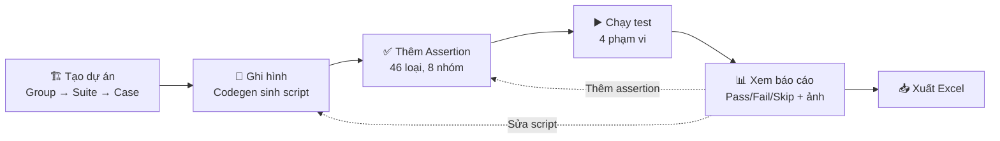
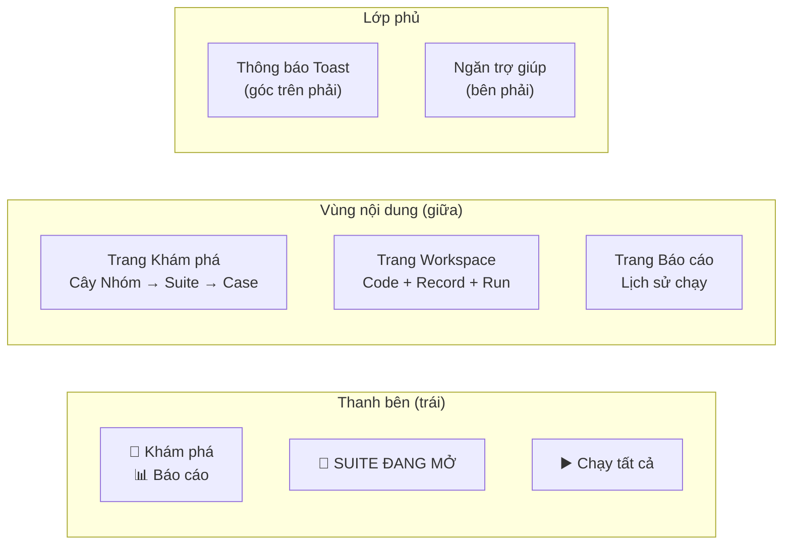
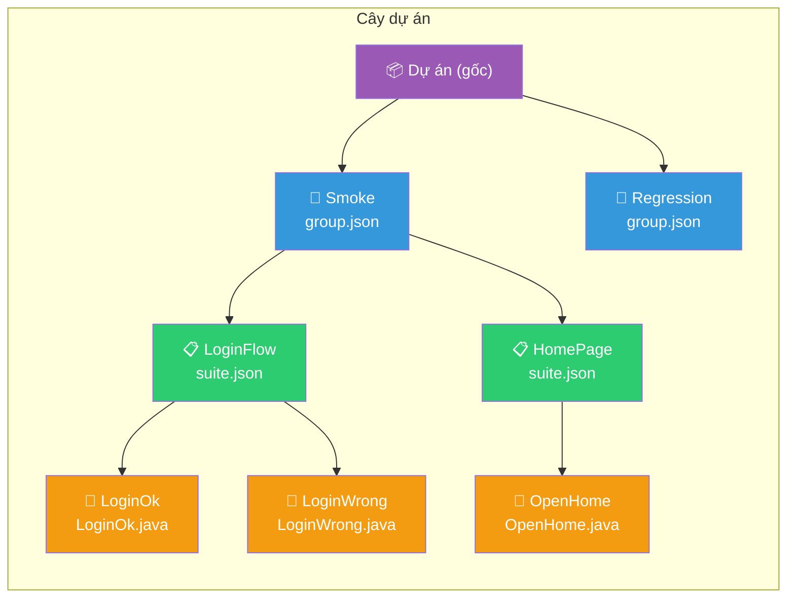
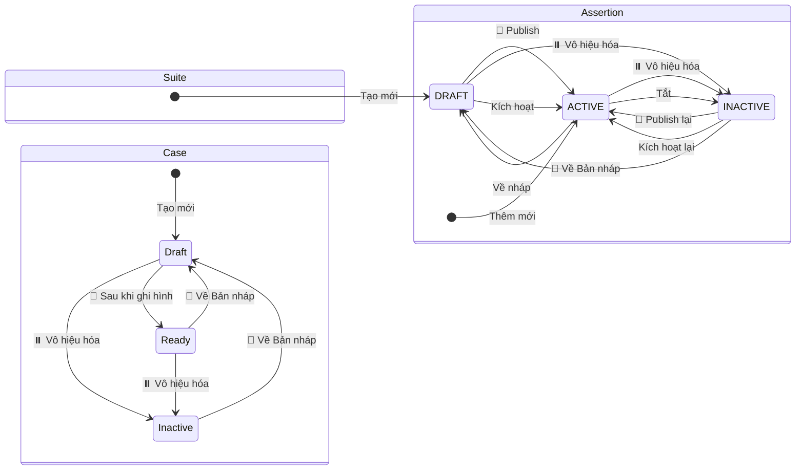
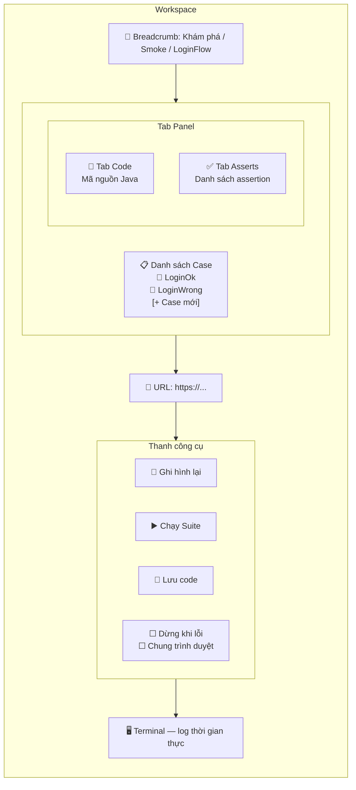
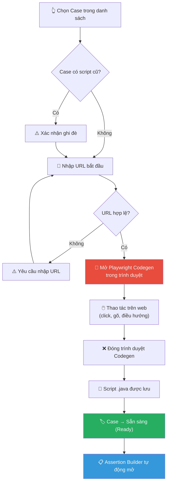
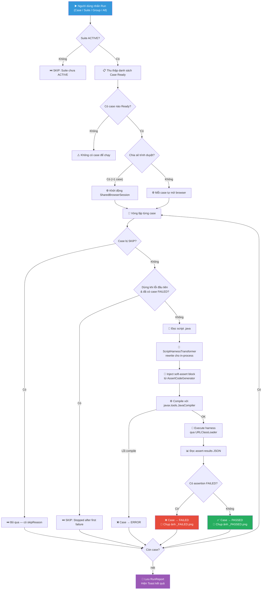
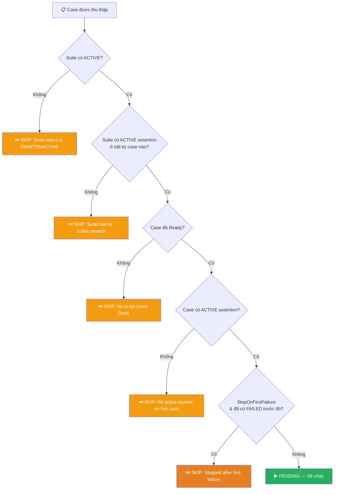
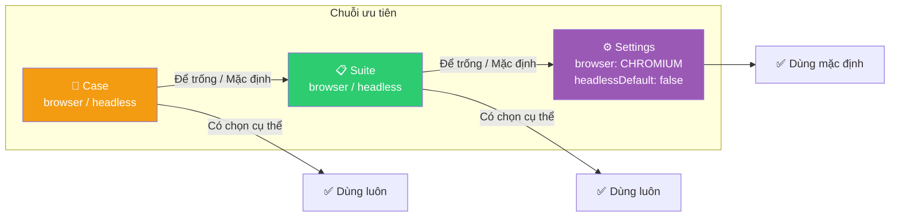

# Hướng dẫn sử dụng — Playwright Automation Studio

> Ứng dụng desktop JavaFX giúp quản lý và tự động hóa kiểm thử web bằng Playwright — không cần viết code thủ công.

---

## Mục lục

1. [Giới thiệu](#1-giới-thiệu)
2. [Giao diện tổng quan](#2-giao-diện-tổng-quan)
3. [Quản lý cây dự án — Explorer](#3-quản-lý-cây-dự-án--explorer)
4. [Tạo & sửa Nhóm / Suite / Case](#4-tạo--sửa-nhóm--suite--case)
5. [Workspace — Ghi hình & Chạy test](#5-workspace--ghi-hình--chạy-test)
6. [Xây dựng Assertion](#6-xây-dựng-assertion)
7. [Chạy test & Báo cáo](#7-chạy-test--báo-cáo)
8. [Xuất Excel](#8-xuất-excel)
9. [Cấu hình ứng dụng](#9-cấu-hình-ứng-dụng)
10. [Phím tắt & Mẹo](#10-phím-tắt--mẹo)

---

## 1. Giới thiệu

**Playwright Automation Studio** cho phép bạn:

- **Ghi hình** thao tác trên trình duyệt bằng Playwright Codegen — tự động sinh code Java
- **Quản lý test** theo cây 3 cấp: Nhóm (Group) → Bộ (Suite) → Ca (Case)
- **Thêm assertion** bằng giao diện trực quan — 46 loại assertion, 8 nhóm chức năng
- **Chạy test** với trình duyệt chia sẻ, chế độ ẩn, dừng khi lỗi đầu tiên
- **Xem báo cáo** chi tiết từng lần chạy: đạt/thất bại/bỏ qua, ảnh chụp màn hình
- **Xuất Excel** 3 sheet: Tổng quan, Cases, Assertions

Ứng dụng chạy test **ngay trong JVM** — không cần terminal, không cần cài đặt riêng Playwright runtime.

### Luồng làm việc tổng thể



---

## 2. Giao diện tổng quan

Giao diện chia làm 3 vùng chính:



### Thanh bên

- **🧭 Khám phá**: Xem cây dự án, tạo/sửa/xóa Group/Suite/Case
- **📊 Báo cáo**: Xem lịch sử các lần chạy test
- **▶️ Chạy tất cả**: Chạy toàn bộ project
- **Thu gọn**: Nhấn nút toggle để thu sidebar còn 56px (chỉ hiện icon)

### Thanh trạng thái (dưới cùng)

Hiển thị trạng thái hiện tại: "Sẵn sàng", "Đang chạy…", "Đang ghi hình…", trình duyệt đang dùng.

---

## 3. Quản lý cây dự án — Explorer

Trang Khám phá hiển thị cây thư mục **Nhóm → Suite → Case**:



### Thao tác trên cây

| Hành động | Cách làm |
|-----------|----------|
| **Chọn** | Click trái vào hàng |
| **Bỏ chọn** | Click lại vào hàng đã chọn |
| **Mở workspace** | Double-click vào Suite hoặc Case |
| **Menu chuột phải** | Click phải vào hàng (không đổi lựa chọn) |
| **Menu vùng trống** | Click phải vào khoảng trống trên cây |
| **Kéo thả** | Kéo Suite sang Nhóm khác để di chuyển; kéo Case để sắp xếp lại trong Suite |

### Panel Xem trước (bên phải)

Khi chọn một node trên cây, panel bên phải hiển thị:

| Node | Hiển thị |
|------|----------|
| **Dự án (gốc)** | Số lượng Nhóm / Suite / Case toàn dự án |
| **Nhóm** | Tên, mô tả, thống kê (Nhóm con, Suite, Case) |
| **Suite** | Tên, mô tả, trạng thái, trình duyệt, headless, ngày tạo/sửa, nút Sửa / Chạy / Mở |
| **Case** | Tên, mô tả, trạng thái, URL, trình duyệt, headless, ngày tạo/sửa, nút Sửa / Chạy / Mở |

Nút **✎ Sửa** mở form chỉnh sửa metadata (mô tả, trạng thái, URL, trình duyệt, headless). Nút **💾 Lưu** ghi thay đổi vào `suite.json`.

### Bộ lọc trạng thái

Combo box phía trên cây cho phép lọc theo trạng thái:

- **📋 Tất cả** — hiện mọi node
- **🟢 Đang hoạt động** — chỉ Suite ACTIVE / Case Ready
- **📝 Bản nháp** — Suite DRAFT / Case Draft
- **⏸️ Không hoạt động** — Suite INACTIVE

---

## 4. Tạo & sửa Nhóm / Suite / Case

### Tạo Nhóm

1. Chọn Nhóm cha (hoặc để trống để tạo ở gốc)
2. Nhấn **📁 Nhóm mới** trên toolbar (hoặc chuột phải → Nhóm mới)
3. Điền **Tên nhóm** (bắt buộc) và Mô tả (tùy chọn)
4. Nhấn **✅ Tạo**

### Tạo Suite

1. Chọn Nhóm cha
2. Nhấn **📋 Suite mới** trên toolbar (hoặc chuột phải → Suite mới)
3. Điền form:
   - **Tên suite** (bắt buộc)
   - **Mô tả**
   - **Trạng thái**: Bản nháp (DRAFT) / Đang hoạt động (ACTIVE) / Không hoạt động (INACTIVE)
   - **Trình duyệt**: «Mặc định (Playwright Chromium)» hoặc chọn trình duyệt cụ thể
   - **🙈 Ẩn trình duyệt**: chạy headless
4. Nhấn **✅ Tạo**

### Tạo Case

1. Chọn Suite cha (trên cây hoặc trong Workspace)
2. Nhấn **🧪 Case mới** trên toolbar (hoặc chuột phải → Case mới)
3. Điền form:
   - **Tên case** (bắt buộc)
   - **Mô tả**
   - **Trạng thái**: Bản nháp (Draft) / Sẵn sàng (Ready) / Không hoạt động (Inactive)
   - **URL bắt đầu**: URL dùng khi ghi hình (codegen)
   - **Trình duyệt** & **Ẩn trình duyệt** (kế thừa từ Suite nếu để «Mặc định»)
4. Nhấn **✅ Tạo**

### Sửa entity

1. Chọn Group / Suite / Case trên cây
2. Nhấn **✎ Sửa** trong panel Xem trước (hoặc chuột phải → Sửa)
3. Cập nhật các trường
4. Nhấn **💾 Lưu**

### Đổi trạng thái Suite

- Chuột phải vào Suite → **🚀 Publish** (→ ACTIVE) / **⏸️ Vô hiệu hóa** (→ INACTIVE) / **📝 Đưa về Bản nháp** (→ DRAFT)
- Hoặc: mở Workspace → chọn trạng thái trong combo box **Thông tin Suite**

### Xóa / Sao chép

- Chuột phải → **🗑️ Xóa** — xóa vĩnh viễn (cả thư mục trên đĩa)
- Chuột phải → **📄 Sao chép** — nhân bản Suite hoặc Case

### Vòng đời trạng thái



| Điều kiện chạy | Yêu cầu |
|----------------|---------|
| **Suite** | Phải ở trạng thái ACTIVE |
| **Case** | Phải ở trạng thái Ready (đã ghi hình) |
| **Assertion** | Phải ACTIVE và thuộc case Ready |
| **Chạy Case đơn** | Case Ready + Suite ACTIVE |
| **Chạy Suite** | Suite ACTIVE |

---

## 5. Workspace — Ghi hình & Chạy test

Workspace mở ra khi bạn double-click vào Suite hoặc Case. Đây là nơi làm việc chính.

### Bố cục Workspace




### Tab Code

Hiển thị mã nguồn Java của case được chọn. Bạn có thể chỉnh sửa trực tiếp.

- **💾 Lưu code**: Lưu file `.java` vào thư mục Suite. Nếu code có thay đổi chưa lưu, tab hiển thị **📝 Code \*** và nút Lưu đổi thành **💾 Lưu code \***.
- Khi chuyển case/tab, nếu code chưa lưu, ứng dụng hỏi: **Lưu / Bỏ thay đổi / Ở lại**.

### Tab Asserts

Hiển thị danh sách assertion của case đang chọn. Mỗi hàng có nút **Sửa** và **Xóa**.

- Combo box lọc theo nhóm assertion: Tất cả, Nội dung trang, Phần tử, v.v.
- Nút **[+ Thêm Assert]** mở Assertion Builder.

### Ghi hình (Record)



> **Lưu ý**: Ghi hình yêu cầu Node.js. Ở chế độ portable, Node.js và Playwright CLI được đóng gói sẵn. Ở chế độ dev, cần `npx playwright` khả dụng.

### Chạy test

#### Luồng chạy test (Run)



#### Chạy một Case

1. Chọn case trong danh sách (case phải ở trạng thái **Sẵn sàng**)
2. Nhấn nút **▶️** bên cạnh tên case (hoặc chuột phải → Chạy Case này)
3. Xem log trong Terminal

#### Chạy cả Suite

1. Suite phải ở trạng thái **Đang hoạt động** (ACTIVE)
2. Nhấn **▶️ Chạy Suite**
3. Tất cả case Ready trong suite được chạy

#### Tùy chọn chạy

| Tùy chọn | Mặc định | Ý nghĩa |
|----------|----------|---------|
| ☐ Dừng khi lỗi đầu tiên | Tắt | Dừng toàn bộ run khi có case FAILED đầu tiên |
| ☐ Chung trình duyệt | Bật | Chia sẻ một BrowserContext cho tất cả case (cookie/session dùng chung) |

---

## 6. Xây dựng Assertion

Assertion Builder mở ra khi:
- Nhấn **[+ Thêm Assert]** trong tab Asserts của Workspace
- Tự động mở sau khi ghi hình xong

### Giao diện Assertion Builder

```
┌──────────────────────────────────────────────┐
│ 📋 Asserts: LoginOk                          │
├──────────────────────────────────────────────┤
│ Danh sách assertion (kéo thả để sắp xếp)     │
│ ┌──────────────────────────────────────────┐ │
│ │ 🟢 Kiểm tra tiêu đề trang = "Login"      │ │
│ │ 📝 Kiểm tra URL chứa "/dashboard"   [Sửa][Xóa]│
│ └──────────────────────────────────────────┘ │
│                                              │
│ [+ Thêm]                                     │
│                                              │
│ Loại: [Kiểm tra tiêu đề trang ▾]             │
│ Giá trị: [Login                    ]         │
│ Locator: [                        ]          │
│ Trạng thái: [🟢 Đang hoạt động ▾]            │
│ ☐ Khớp chính xác    Timeout: [30]s           │
│                                              │
│                              [Hủy] [💾 Lưu]  │
└──────────────────────────────────────────────┘
```

### 46 loại Assertion — 8 nhóm

```markmap
# 46 Loại Assertion
## Nội dung trang
- Tiêu đề trang
- URL hiện tại
- Văn bản trang
- HTML nguồn
## Phần tử
- Văn bản phần tử
- Tồn tại / Hiển thị / Ẩn
- Enabled / Disabled
- Thuộc tính (attribute)
- CSS class / CSS style
- Số lượng phần tử
- Văn bản chứa (contains)
- Vị trí / Kích thước
- Focus / Placeholder
- Value / Checked / Selected
## Ảnh & Media
- Alt text
- src ảnh
- Kích thước ảnh
- Trạng thái tải
- Video / Audio
## File & Download
- File đã tải xuống
- Tên file
- Kích thước file
- Nội dung file
## Bảng (Table)
- Số dòng / Số cột
- Giá trị ô
- Tiêu đề cột
- Tổng số dòng
## Form & Input
- Giá trị input
- Validation
- Required / Pattern
- Maxlength
- Disabled / Placeholder
- Checked
## Trang & Mạng
- HTTP status
- Response time
- Console error
- JavaScript error
- Cookie
- localStorage
## JS Tùy chỉnh
- Đoạn JavaScript custom
```

### Thêm assertion

1. Chọn **Loại** từ dropdown
2. Điền **Giá trị** mong đợi (và Locator nếu cần)
3. Chọn **Trạng thái**: ACTIVE (chạy) / DRAFT (nháp) / INACTIVE (tắt)
4. Tùy chọn: ☐ Khớp chính xác (exact match), Timeout (ms)
5. Nhấn **+ Thêm** (hoặc chọn hàng → Sửa → nút đổi thành Cập nhật)
6. Nhấn **💾 Lưu** để ghi vào `suite.json`

### Sắp xếp assertion

Kéo thả các hàng trong danh sách để thay đổi thứ tự thực thi.

### Xóa assertion

Nhấn nút **Xóa** trên hàng assertion.

---

## 7. Chạy test & Báo cáo

### Các phạm vi chạy

| Phạm vi | Cách kích hoạt | Mô tả |
|---------|---------------|-------|
| **Tất cả** | Sidebar ▶️ Chạy tất cả | Mọi Suite ACTIVE + Case Ready trong toàn dự án |
| **Nhóm** | Chuột phải vào Nhóm → Chạy nhóm | Đệ quy tất cả Suite trong Nhóm |
| **Suite** | Nút ▶️ Chạy Suite trong Workspace | Tất cả Case Ready trong Suite |
| **Case** | Nút ▶️ trên hàng case | Một case đơn lẻ |

### Trang Báo cáo

Vào **📊 Báo cáo** từ thanh bên để xem lịch sử chạy:

| Cột | Ý nghĩa |
|-----|---------|
| Run ID | Mã lần chạy (yyyyMMdd-HHmmss) |
| Phạm vi | ALL / GROUP / SUITE / CASE |
| Mục tiêu | Tên scope được chạy |
| Kết quả | 🟢 x đạt / 🔴 y thất bại / ⏭️ z bỏ qua |
| Thời gian | Tổng thời gian chạy |
| Trình duyệt | Browser đã dùng |
| Bắt đầu | Thời điểm bắt đầu |

**Bộ lọc**: combo box cho phép lọc theo phạm vi, kết quả (Tất cả / Có lỗi / Toàn đạt), Suite.

### Trang Chi tiết báo cáo

Click vào hàng trong trang Báo cáo để xem chi tiết:

- **Tổng quan**: số case đạt / thất bại / bỏ qua, thời gian, cấu hình
- **Bảng Cases**: từng case với trạng thái, thời gian, lý do lỗi
- **Bảng Asserts**: chọn một case để xem chi tiết từng assertion — loại, giá trị, kết quả, thông báo lỗi
- **Ảnh chụp màn hình**: mỗi case có ảnh `_PASSED.png` hoặc `_FAILED.png`
- **Nút Xuất Excel**: xuất báo cáo ra file `.xlsx`

### Logic bỏ qua (skip)



---

## 8. Xuất Excel

Từ trang Chi tiết báo cáo, nhấn **📥 Xuất Excel**. File `.xlsx` gồm 3 sheet:

| Sheet | Nội dung |
|-------|----------|
| **Tổng quan** | Run ID, phạm vi, trình duyệt, thời gian, tổng kết Passed/Failed/Skipped |
| **Cases** | Từng case: tên, suite, trạng thái, thời gian, lý do lỗi |
| **Asserts** | Từng assertion: loại, giá trị, kết quả (PASSED/FAILED/SKIPPED), thông báo |

File được lưu vào thư mục `data/exports/` theo mặc định. Có thể chọn vị trí khác qua dialog Save As.

---

## 9. Cấu hình ứng dụng

File cấu hình: `data/config/settings.json`

```json
{
  "browser": "CHROMIUM",
  "headlessDefault": false,
  "shareContextDefault": true,
  "stopOnFirstFailureDefault": false
}
```

| Khóa | Giá trị | Mặc định | Ý nghĩa |
|------|---------|----------|---------|
| `browser` | `CHROMIUM`, `FIREFOX`, `WEBKIT`, `CHROME`, `EDGE` | `CHROMIUM` | Trình duyệt mặc định |
| `headlessDefault` | `true` / `false` | `false` | Chạy ẩn trình duyệt |
| `shareContextDefault` | `true` / `false` | `true` | Chia sẻ BrowserContext giữa các case |
| `stopOnFirstFailureDefault` | `true` / `false` | `false` | Dừng khi gặp lỗi đầu tiên |

### Kế thừa cấu hình



Ví dụ: nếu Case không chọn trình duyệt cụ thể («Mặc định»), hệ thống sẽ kiểm tra Suite. Nếu Suite cũng để mặc định, dùng Playwright Chromium.

### Đường dẫn APP_HOME

Thư mục gốc của ứng dụng (`APP_HOME`) được xác định theo thứ tự:

1. Tham số JVM: `-Dstudio.home=/đường/dẫn`
2. Biến môi trường: `STUDIO_HOME`
3. Biến môi trường: `APP_HOME`
4. Thư mục cha của JAR (chế độ portable)
5. `user.dir` hiện tại (chế độ dev)

---

## 10. Phím tắt & Mẹo

### Phím tắt

| Thao tác | Cách làm |
|----------|----------|
| Mở Workspace | Double-click Suite hoặc Case |
| Bỏ chọn node | Click lại vào node đã chọn |
| Menu ngữ cảnh | Chuột phải (không đổi selection) |
| Thu gọn sidebar | Nút toggle trên thanh bên |

### Mẹo

- **URL tự động điền**: Sau khi ghi hình, URL được trích xuất từ `page.navigate(...)` trong script và tự động điền vào ô URL của case.
- **Code dơ (dirty)**: Tab Code hiển thị dấu `*` khi code có thay đổi chưa lưu. Chuyển case/tab sẽ hỏi xác nhận.
- **Panel Xem trước**: Chọn Suite/Case trên cây để xem metadata mà không cần mở Workspace. Sửa trực tiếp và nhấn Lưu.
- **Terminal**: Tự động hiện khi Record/Run. Có thể ẩn bằng nút **Ẩn** hoặc xóa nội dung bằng **Xóa**.
- **Trợ giúp**: Nhấn nút ❔ trên thanh bên để mở ngăn trợ giúp bên phải.

---

## Cấu trúc thư mục dự án

```
APP_HOME/
├── data/
│   ├── config/settings.json     # Cấu hình người dùng
│   ├── project/                 # Cây Group/Suite/Case
│   │   └── Nhóm/
│   │       ├── group.json
│   │       └── Suite/
│   │           ├── suite.json   # Suite metadata + cases[] + assertions[]
│   │           └── Case.java    # Script Playwright
│   ├── reports/                 # Lịch sử chạy + ảnh chụp
│   └── exports/                 # File Excel xuất ra
└── work/                        # Tạm — an toàn để xóa
    └── harness/                 # Script đã biên dịch cho mỗi lần chạy
```

---

*Playwright Automation Studio — Built with JavaFX 26.0.1 + Playwright 1.61.0*
