# Hướng dẫn sử dụng Test Studio

> Ứng dụng desktop JavaFX giúp **ghi hình, tổ chức và chạy tự động** kiểm thử web bằng Playwright — không cần viết code thủ công.

Bộ tài liệu này mô tả **đúng trạng thái hiện tại của mã nguồn** (nhánh `main`). Hình ảnh là ảnh chụp thật do chính bộ FXML/CSS/controller của ứng dụng dựng lên với dữ liệu mẫu.

| | |
|---|---|
| Phiên bản | 2.2.0 (`pom.xml`) |
| Nền tảng | JavaFX 26.0.1 · Playwright Java 1.61.0 · JDK 26+ |
| Chủ đề | Tối (Catppuccin Mocha) / Sáng — đổi bằng nút *Sáng/Tối* ở góc trên phải |
| Ngôn ngữ giao diện | Tiếng Việt |

---

## Mục lục

1. [Giới thiệu](#1-giới-thiệu)
2. [Cài đặt & khởi chạy](#2-cài-đặt--khởi-chạy)
3. [Giao diện tổng quan](#3-giao-diện-tổng-quan)
4. [Explorer — quản lý cây dự án](#4-explorer--quản-lý-cây-dự-án)
5. [Tạo Nhóm / Suite / Case](#5-tạo-nhóm--suite--case)
6. [Workspace — ghi hình & chạy test](#6-workspace--ghi-hình--chạy-test)
7. [Assertion Builder — 46 loại kiểm tra](#7-assertion-builder--46-loại-kiểm-tra)
8. [Báo cáo, bằng chứng và xuất file](#8-báo-cáo-bằng-chứng-và-xuất-file)
9. [Trợ lý AI](#9-trợ-lý-ai)
10. [Cài đặt, dọn dẹp dữ liệu & chủ đề](#10-cài-đặt-dọn-dẹp-dữ-liệu--chủ-đề)
11. [Ngăn trợ giúp trong ứng dụng](#11-ngăn-trợ-giúp-trong-ứng-dụng)
12. [Chạy trên dòng lệnh, đóng gói & tích hợp CI](#12-chạy-trên-dòng-lệnh-đóng-gói--tích-hợp-ci)
13. [Cấu trúc dữ liệu & đường dẫn](#13-cấu-trúc-dữ-liệu--đường-dẫn)
14. [Mẹo sử dụng](#14-mẹo-sử-dụng)
15. [Xử lý sự cố](#15-xử-lý-sự-cố)
16. [Câu hỏi thường gặp](#16-câu-hỏi-thường-gặp)

---

## 1. Giới thiệu

**Test Studio** là công cụ kiểm thử tự động tự chứa: bạn thao tác trên trình duyệt, Playwright Codegen ghi lại thành kịch bản Java, bạn bổ sung điều kiện đạt/không đạt (assertion) bằng giao diện, rồi chạy lại — từng case, từng suite, hay toàn bộ dự án.

Điểm khác biệt chính:

- **Chạy trong chính JVM của ứng dụng** — không mở terminal, không cấu hình Playwright runtime riêng.
- **Cùng một bộ mã ở cấu hình dev và bản portable** (gói kèm JRE + Node.js + Playwright CLI + Chromium).
- **Báo cáo có bằng chứng**: mỗi case sau khi chạy đều có ảnh chụp màn hình, xem được trong ứng dụng và xuất được thành HTML/Excel.
- **Trợ lý AI** phân tích tài liệu nghiệp vụ hoặc ảnh mockup để sinh case + kịch bản Playwright.

### Luồng làm việc

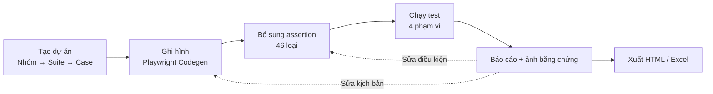

---

## 2. Cài đặt & khởi chạy

### 2.1. Yêu cầu

| Thành phần | Phiên bản | Ghi chú |
|---|---|---|
| JDK | 26 trở lên | `maven-enforcer-plugin` chặn build nếu JDK cũ hơn |
| Maven | 3.9+ | Chỉ cần khi chạy từ mã nguồn |
| Node.js | 20+ | Cần cho chức năng **Ghi hình** ở bản dev; bản portable đã kèm sẵn |

### 2.2. Chạy từ mã nguồn

```bash
git clone <repository-url>
cd GUI-test-tool
mvn javafx:run
```

Ứng dụng khởi động với cây dự án hiện có trong `data/project` (rỗng nếu là lần đầu). Nếu chưa có gì, bắt đầu bằng **+ Nhóm mới**.

### 2.3. Bản portable (không cần cài đặt)

```bash
# macOS / Linux
bash scripts/build-portable.sh

# Windows
scripts\build-portable.bat
```

Lệnh trên tạo gói trong `dist/` chứa JRE, Node.js và Chromium; giải nén và chạy `run.sh` / `run.bat`. Máy đích **không cần** JDK, Node hay Maven. Chi tiết đóng gói: [docs/BUILD.md](../BUILD.md). Có cả script tạo bộ cài (`scripts/build-installer.sh` / `.bat`).

### 2.4. Chủ đề Tối và Sáng

Mọi màn hình trong tài liệu này có **hai phiên bản ảnh**: chủ đề Tối (mặc định, `images/01-explorer.png`) và chủ đề Sáng (`images/light-01-explorer.png`). Chuyển bằng nút **Sáng / Tối** ở góc trên phải — giao diện đổi ngay, không cần khởi động lại.

---

## 3. Giao diện tổng quan

**Chủ đề Tối (mặc định):**


**Chủ đề Sáng:**

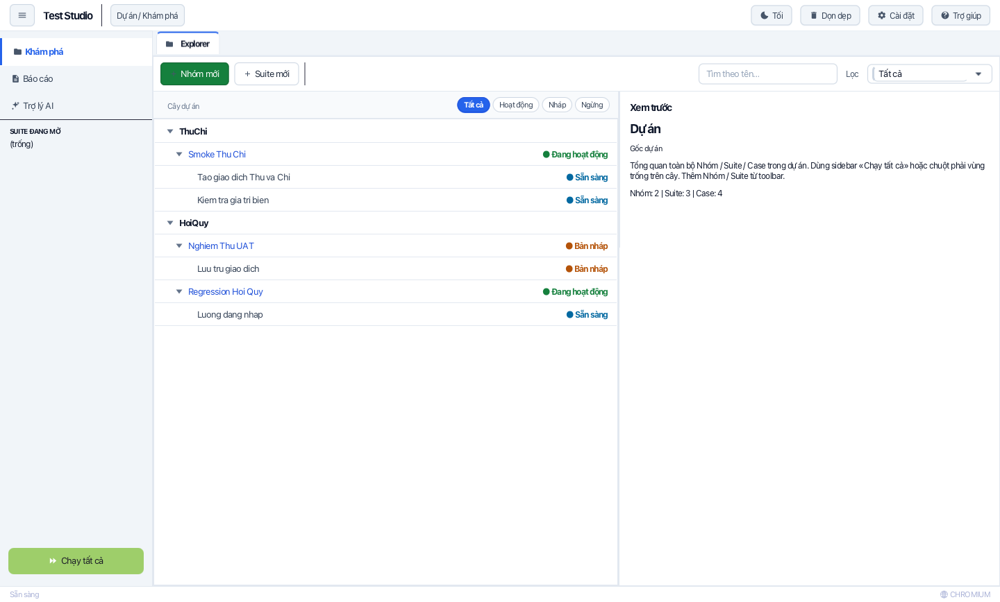

Bố cục gồm bốn vùng cố định:

| Vùng | Nội dung |
|---|---|
| **Thanh bên trái** (220 px, thu gọn còn 56 px) | `Khám phá`, `Báo cáo`, `Trợ lý AI`; khối **SUITE ĐANG MỞ**; nút **Chạy tất cả** |
| **Thanh tab** trên cùng | Mỗi trang/suite/báo cáo là một tab — `Explorer` luôn mở, các tab khác có nút ✕ |
| **Breadcrumb** (`Dự án / …`) | Cho biết bạn đang ở đâu: `Dự án / Khám phá`, `Dự án > Suite: X`, `Dự án > Báo cáo > …` |
| **Thanh trạng thái** dưới cùng | Trạng thái hiện tại (`Sẵn sàng`, `Đang chạy…`, `Đang ghi hình…`) và trình duyệt đang dùng |

Bốn nút ở góc trên phải:

- **Sáng / Tối** — đổi chủ đề, lưu vào `data/config/settings.json`.
- **Dọn dẹp** — mở hộp thoại dọn dữ liệu (mục [10.3](#103-dọn-dẹp-dữ-liệu)).
- **Cài đặt** — trình duyệt mặc định, tuỳ chọn chạy và cấu hình AI.
- **Trợ giúp** — mở ngăn hướng dẫn nhanh bên phải (mục [11](#11-ngăn-trợ-giúp-trong-ứng-dụng)).

Khi đang chạy test, nút **⏹ Dừng** xuất hiện cạnh nhóm nút này.

> **Thông báo (toast):** mọi thao tác (tạo/sửa/xoá, ghi hình, chạy, xuất file) đều hiện toast ở góc dưới phải, phân biệt thành công / thông tin / cảnh báo / lỗi.

---

## 4. Explorer — quản lý cây dự án

Explorer tổ chức kiểm thử theo **ba cấp**: `Nhóm → Suite → Case`, lưu trên đĩa trong `data/project`.

### 4.1. Bố cục


- **Cột trái** — cây dự án. Mỗi dòng có nhãn trạng thái: `● Đang hoạt động` (Suite ACTIVE), `● Sẵn sàng` (Case Ready), `● Nháp` (Draft/DRAFT), `● Ngừng` (Inactive/INACTIVE).
- **Cột phải — Xem trước** — thông tin của mục đang chọn (tên, mô tả, trạng thái, thống kê `Nhóm / Suite / Case`), kèm nút **Sửa** để cập nhật metadata ngay tại Explorer.
- **Thanh công cụ** — `+ Nhóm mới`, `+ Suite mới`, ô `Tìm theo tên…`, bộ lọc trạng thái (`Tất cả`, `Hoạt động`, `Nháp`, `Ngừng`).

### 4.2. Thao tác trên cây

| Thao tác | Cách làm |
|---|---|
| Chọn | Click một dòng — bảng Xem trước cập nhật ngay; click lần nữa để bỏ chọn |
| Mở Workspace | Double-click vào **Suite** |
| Menu ngữ cảnh | Chuột phải: `Sửa`, `Sao chép`, `Xóa`, `Chạy` (tuỳ cấp) |
| Di chuyển | Kéo-thả Suite sang Nhóm khác; kéo-thả để đổi thứ tự |
| Thêm nhanh | Di chuột lên dòng để hiện nút `+ Thêm` / `▶ Chạy` / `✏️ Sửa` / `📋 Sao chép` |

### 4.3. Quy tắc dữ liệu

- Một thư mục là **Nhóm** khi có `group.json`, là **Suite** khi có `suite.json`.
- Mỗi case là một file `.java` trong thư mục suite, tên file = trường `scriptFile` của case.
- Cây được đọc lại từ đĩa mỗi lần mở Explorer, nên chỉnh sửa thủ công trong thư mục cũng được phản ánh.

---

## 5. Tạo Nhóm / Suite / Case

Bấm **+ Nhóm mới**, **+ Suite mới** (Explorer) hoặc **+ Case mới** (Workspace) để mở biểu mẫu.

| Tạo Nhóm mới (Tối) | Tạo Case mới (Tối) |
|---|---|
| 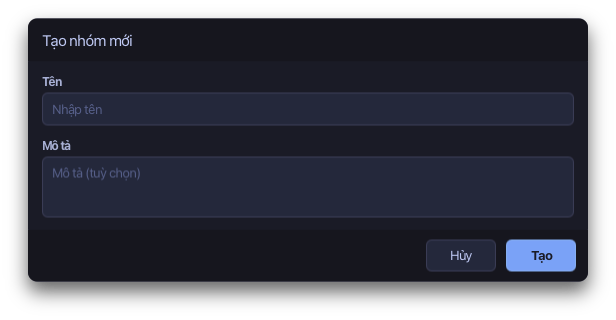 | 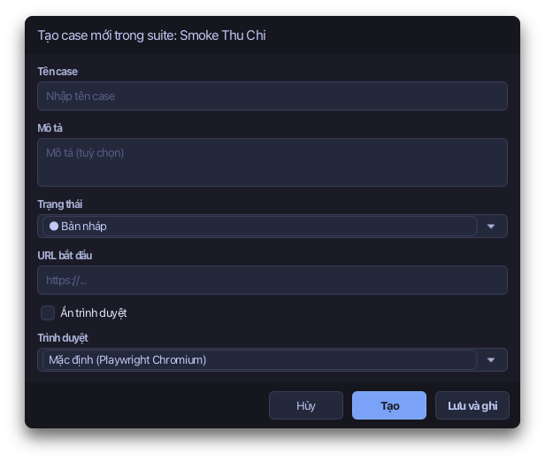 |

| Tạo Nhóm mới (Sáng) | Tạo Case mới (Sáng) |
|---|---|
| 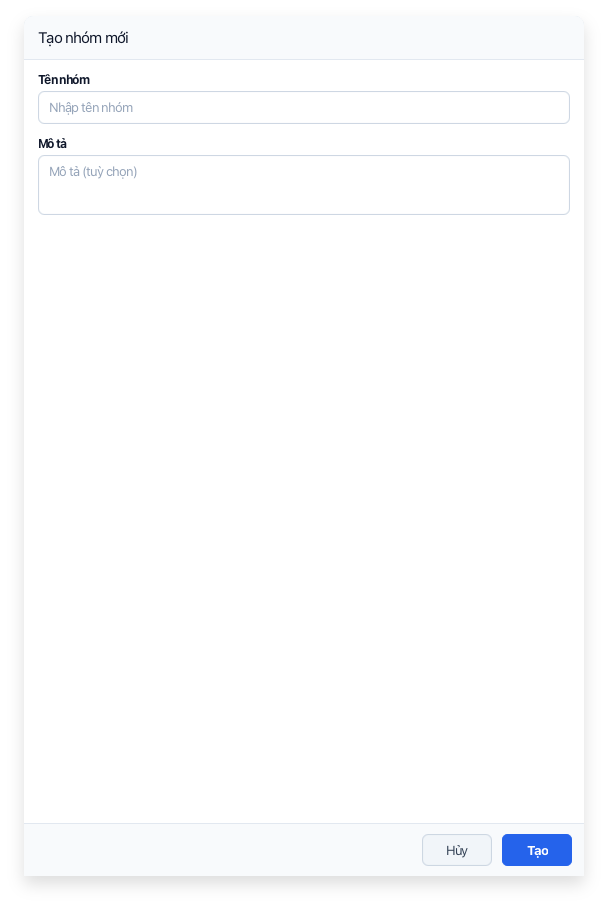 | 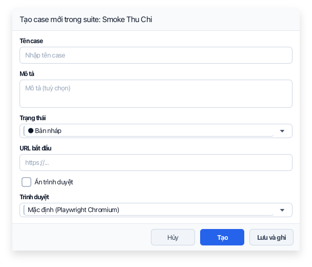 |

| Cấp | Trường bắt buộc | Trường tuỳ chọn |
|---|---|---|
| **Nhóm** | Tên | Mô tả |
| **Suite** | Tên | Mô tả, Trạng thái (`DRAFT` / `ACTIVE` / `INACTIVE`), Trình duyệt, *Ẩn trình duyệt* |
| **Case** | Tên | Mô tả, Trạng thái (`Draft` / `Ready` / `Inactive`), **URL bắt đầu**, Trình duyệt, *Ẩn trình duyệt* |

- Biểu mẫu Case có thêm nút **Lưu và ghi** — lưu case rồi mở trình duyệt ghi hình ngay (phải nhập URL bắt đầu trước).
- Tên không được để trống: biểu mẫu báo `⚠️ Tên không được để trống` ngay dưới ô nhập.
- Case mới có kịch bản khung (`package com.test; … public static void main`) — hãy ghi hình hoặc viết lại trước khi đặt trạng thái `Ready`.
- Chọn *Ẩn trình duyệt* sẽ ẩn ô chọn trình duyệt (dùng cho CI / chạy nền).
- **Sửa** mở lại biểu mẫu với giá trị đã điền; **Sao chép** nhân bản mục (kể cả file kịch bản) cùng cấp; **Xóa** yêu cầu xác nhận và áp dụng cho cả cây con.

---

## 6. Workspace — ghi hình & chạy test

Mở bằng double-click vào Suite trong Explorer.

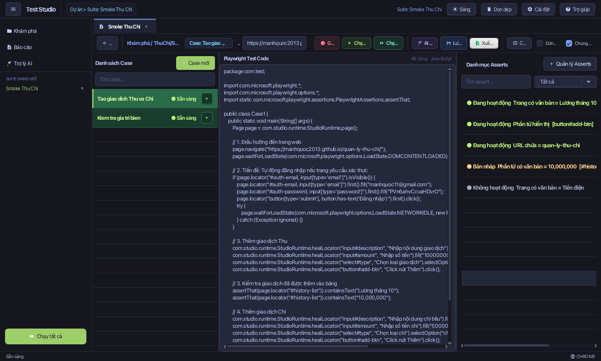

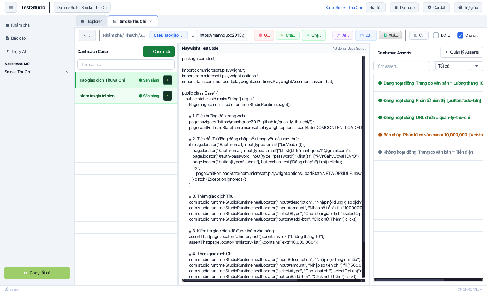

### 6.1. Các vùng trong Workspace

| Vùng | Chức năng |
|---|---|
| **Cột Case** (trái) | Danh sách case của suite, ô tìm kiếm, nút `+ Case mới`; mỗi dòng có nút ▶ để chạy riêng case |
| **Thanh hành động** (trên) | `Quay lại`, `Case: <tên>`, URL bắt đầu, `Ghi hình`, `Chạy case`, `Chạy suite`, `AI Hỗ trợ`, `Lưu code`, `Xuất Excel`, `Chia đôi`, tuỳ chọn `Dừng khi lỗi` / `Chung context` |
| **Code editor** (giữa) | Kịch bản Java Playwright của case đang chọn; nhãn `● Chưa lưu` cảnh báo thay đổi chưa ghi đĩa |
| **Danh mục Asserts** (phải) | Assertion của case, ô `Tìm assert…`, lọc theo nhóm, nút `+ Quản lý Asserts` |
| **Terminal** (dưới, tự hiện) | Log của lượt ghi hình/chạy; nút `Xóa log`, `Ẩn` |

Khi chưa chọn case, Workspace hiện **Thông tin Suite**: tên, bộ đổi trạng thái, thống kê `Case / Sẵn sàng / Có thể chạy`, mô tả và nút `+ Case mới`.

### 6.2. Ghi hình một case

1. Chọn case ở cột trái (case phải có **URL bắt đầu**).
2. Kiểm tra/điền URL trong ô `https://example.com — dùng khi ghi hình / chạy`.
3. Bấm **🔴 Ghi hình** → Playwright Codegen mở trình duyệt (Chromium mặc định, hoặc trình duyệt cấu hình cho case/suite).
4. Thao tác trên trình duyệt như người dùng thật.
5. **Đóng trình duyệt** → kịch bản được sinh và lưu vào file `.java` của case.
6. Assertion Builder mở tự động để bạn thêm điều kiện kiểm tra.

> Trong lúc ghi, thanh trạng thái hiện `Đang ghi hình…`. Cần Node.js + Playwright CLI ở bản dev; bản portable đã kèm sẵn.

### 6.3. Sửa kịch bản

- Gõ trực tiếp vào editor, nhãn `● Chưa lưu` xuất hiện khi nội dung khác bản trên đĩa.
- Bấm **💾 Lưu code** để ghi xuống file. Rời case khi còn thay đổi → ứng dụng hỏi xác nhận.
- **Chia đôi** bố trí Code và Asserts cạnh nhau; **Toàn màn hình Code** gộp lại một cột.

### 6.4. Chạy test

| Phạm vi | Cách vào | Đặc điểm |
|---|---|---|
| **Case** | `▶ Chạy case` trong Workspace hoặc ▶ trên dòng case | Chạy một case |
| **Suite** | `▶ Chạy suite` trong Workspace | Mọi case *Ready* của suite |
| **Nhóm** | Chuột phải vào Nhóm ở Explorer → `Chạy` | Đệ quy xuống các Suite |
| **Toàn dự án** | Nút `Chạy tất cả` ở thanh bên | Mọi case *Ready* trong dự án |

Tuỳ chọn chạy:

- **Dừng khi lỗi** — dừng lượt chạy ngay khi gặp case FAILED đầu tiên.
- **Chung context** — bật (mặc định): cả lượt chạy dùng **một BrowserContext**, nên cookie, `localStorage` và phiên đăng nhập được giữ qua các case. Tắt để chạy mỗi case trong context sạch.

Trong lúc chạy: thanh trạng thái hiện `Đang chạy…`, nút **⏹ Dừng** xuất hiện để huỷ lượt chạy, terminal hiển thị log từng bước. **Khi lượt chạy kết thúc, ứng dụng tự mở trang Báo cáo chi tiết** của lượt đó.

**Điều kiện chạy:** Suite phải `ACTIVE`, case phải `Ready`, và phải có ít nhất một assertion `ACTIVE`. Mục không đạt điều kiện bị bỏ qua kèm lý do trong report.

### 6.5. Xuất danh sách case

Nút **Xuất Excel** trong Workspace xuất danh sách case của suite hiện tại (kèm bước và assertion) ra file `.xlsx`.

### 6.6. Động cơ Tự phục hồi Playwright Tối ưu (Optimized Self-Healing Engine)

Trong kiểm thử E2E, selector phần tử web rất dễ bị gãy do ID sinh động (`#btn-submit-89312`), hash class thay đổi sau mỗi lần build Webpack/Vite (`.button__3x9a`), hoặc cấu trúc phân cấp DOM thay đổi nhẹ.

Test Studio tích hợp động cơ tự phục hồi thông minh `OptimizedSelfHealingExecutor`:
- **Fast-path Execution**: Khi selector gốc vẫn tìm thấy phần tử, Playwright thực thi ngay lập tức mà không phát sinh bất kỳ độ trễ hay chi phí tính toán nào.
- **Đa chiến lược Heuristic tức thời (<30ms)**: Khi locator gặp lỗi `PlaywrightException`:
  1. *Lọc bỏ ID động*: Chuyển `#input-username-9821` thành `[id^='input-username']`.
  2. *Chuẩn hóa văn bản*: Tìm kiếm text mờ không phân biệt hoa thường và loại bỏ khoảng trắng thừa.
  3. *Ánh xạ vai trò ARIA & Thuộc tính ngữ nghĩa*: Tìm theo `data-testid`, `aria-label`, placeholder, role (`button`, `textbox`).
- **Bộ bọc trong suốt `HealedLocatorWrapper`**: Bọc Playwright Locator trong suốt, tự động phục hồi và phát sự kiện `HealedEvent` để ghi nhận selector thay thế vào kết quả chạy và nhật ký.
- **Bộ nhớ đệm tự phục hồi (Self-Healing Cache)**: Lưu lại selector đã vá thành công kèm thời gian sống (TTL), giúp các bước kiểm thử kế tiếp trong phiên chạy tái sử dụng ngay tức thì (<1ms).

---

## 7. Assertion Builder — 46 loại kiểm tra

Mở bằng nút **+ Quản lý Asserts** trong Workspace (chọn case trước).

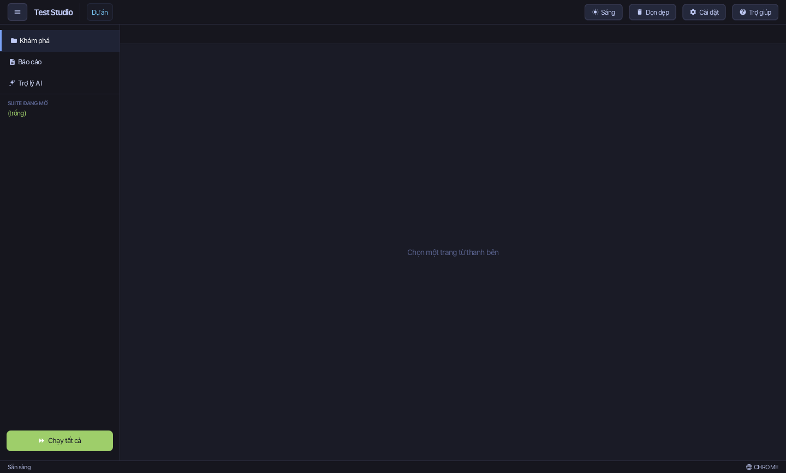

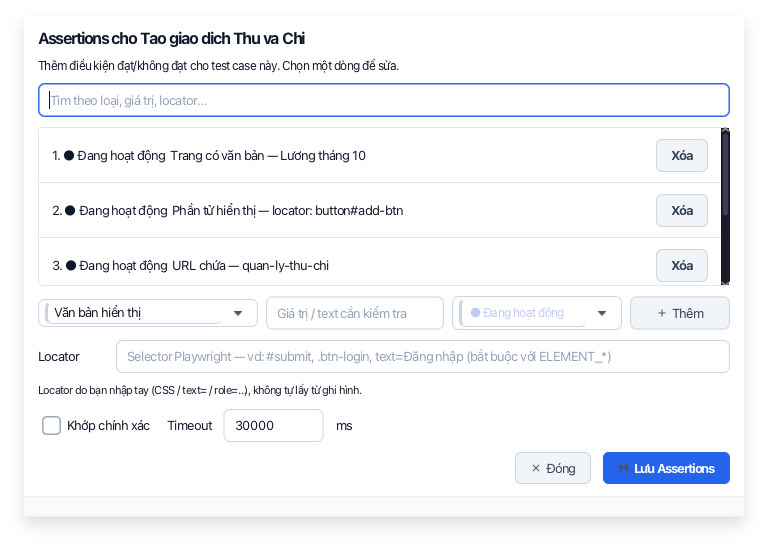

> Ảnh chụp cho thấy đủ các thành phần: tiêu đề, ô tìm, danh sách assertion (kèm nút **Xóa**), hàng thêm mới (Loại / Giá trị / Trạng thái / Thêm), hàng Locator, tuỳ chọn *Khớp chính xác* + *Timeout*, và nút `Đóng` / `Lưu Assertions`.

### 7.1. Thành phần

| Trường | Ý nghĩa |
|---|---|
| Ô tìm | Lọc danh sách theo loại, giá trị, locator |
| **Loại kiểm tra** | Một trong 46 loại (bảng 7.2), hiển thị bằng nhãn tiếng Việt |
| **Giá trị / text cần kiểm tra** | Văn bản mong đợi, số lượng, hoặc biểu thức tuỳ loại |
| **Trạng thái** | `ACTIVE` (chạy) · `DRAFT` (nháp, không chạy) · `INACTIVE` (tắt) |
| **Locator** | Selector Playwright — `#submit`, `.btn-login`, `text=Đăng nhập`, `role=button[name="Lưu"]` |
| **Khớp chính xác** | So khớp nguyên văn thay vì "chứa" |
| **Timeout** | Giờ chờ tối đa cho assertion (ms) |

Nhấn **Thêm** để đưa assertion vào danh sách (chọn một dòng để sửa lại), **Lưu Assertions** để ghi xuống `suite.json`, **Đóng** (hoặc `Esc`) để thoát — có cảnh báo khi còn thay đổi chưa lưu. **Kéo-thả** trong danh sách để đổi thứ tự thực thi.

> Assertion nhóm `ELEMENT_*`, `TABLE_*`, `INPUT_*`, `SELECT_*`, `ATTRIBUTE_EQUALS`… **bắt buộc** có Locator. Locator do bạn nhập tay (CSS / `text=` / `role=`), không tự lấy từ bước ghi hình.

### 7.2. Danh mục 46 loại

| Nhóm | Loại (mã) |
|---|---|
| **Văn bản** | `TEXT_VISIBLE`, `TEXT_NOT_VISIBLE`, `TEXT_EXACT`, `HEADING_VISIBLE`, `PAGE_HAS_TEXT` |
| **Tiêu đề & URL** | `TITLE_CONTAINS`, `TITLE_EQUALS`, `URL_CONTAINS`, `URL_EQUALS`, `URL_MATCHES` |
| **Phần tử** | `ELEMENT_VISIBLE`, `ELEMENT_HIDDEN`, `ELEMENT_ENABLED`, `ELEMENT_DISABLED`, `ELEMENT_EDITABLE`, `ELEMENT_CHECKED`, `ELEMENT_UNCHECKED`, `ELEMENT_COUNT`, `ELEMENT_HAS_TEXT`, `ELEMENT_HAS_VALUE`, `ATTRIBUTE_EQUALS`, `CSS_CONTAINS`, `LINK_HREF_CONTAINS` |
| **Ảnh & media** | `IMAGE_VISIBLE`, `IMAGE_COUNT`, `VIDEO_VISIBLE`, `AUDIO_VISIBLE` |
| **File & tải xuống** | `FILE_DOWNLOADED`, `FILE_NAMED`, `FILE_EXTENSION` |
| **Bảng** | `TABLE_HAS_TEXT`, `TABLE_ROW_COUNT`, `TABLE_CELL_EQUALS`, `TABLE_HEADER_CONTAINS` |
| **Form & nhập liệu** | `INPUT_VALUE_EQUALS`, `INPUT_VALUE_CONTAINS`, `PLACEHOLDER_EQUALS`, `SELECT_HAS_OPTION`, `FORM_VALID`, `FORM_INVALID` |
| **Trang & lưu trữ** | `NO_CONSOLE_ERROR`, `COOKIE_EXISTS`, `LOCAL_STORAGE_EQUALS`, `SESSION_STORAGE_EQUALS` |
| **Tuỳ chỉnh** | `CUSTOM`, `CUSTOM_JS` |

### 7.3. Danh mục Asserts trong Workspace

Cột phải lọc theo 8 nhóm: `Văn bản`, `Phần tử`, `URL`, `Tiêu đề`, `Bảng`, `Form`, `Lưu trữ`, `Tuỳ chỉnh`. Mỗi dòng hiển thị nhãn loại + giá trị rút gọn + locator kèm chấm trạng thái (🟢 hoạt động / 🟡 nháp / ⚪ ngừng).

### 7.4. Soft-assert & Điểm số bao phủ

Trong một case, **mọi assertion ACTIVE đều được thực thi** dù có assertion trước đó thất bại. Kết quả từng assertion (đạt / sai / bỏ qua kèm lý do) được ghi nhận chi tiết; case chỉ PASSED khi tất cả assertion ACTIVE đều đạt.

### 7.5. Đối soát kết quả runtime (Reconciliation)

Tầng kiểm thử `StudioAssertions` và `StudioRuntime` thực hiện:
- Biên dịch 46 loại assertion từ giao diện thành mã kiểm tra Java native thông qua `AssertCodeGenerator`.
- Tự động đối soát (Reconciliation) giữa các điều kiện assertion định nghĩa trong `suite.json` với dữ liệu thực tế thu được trong quá trình chạy.
- Ghi nhận trạng thái chính xác (`PASSED`, `FAILED`, `SKIPPED`) và giá trị thực tế/kỳ vọng vào mô hình `AssertResult` để hiển thị trực tiếp trên báo cáo lượt chạy.

---

## 8. Báo cáo, bằng chứng và xuất file

### 8.1. Danh sách báo cáo

Mở bằng `Báo cáo` ở thanh bên.

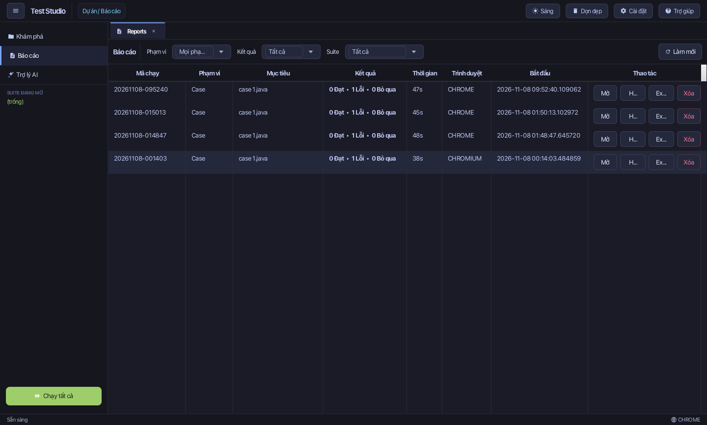

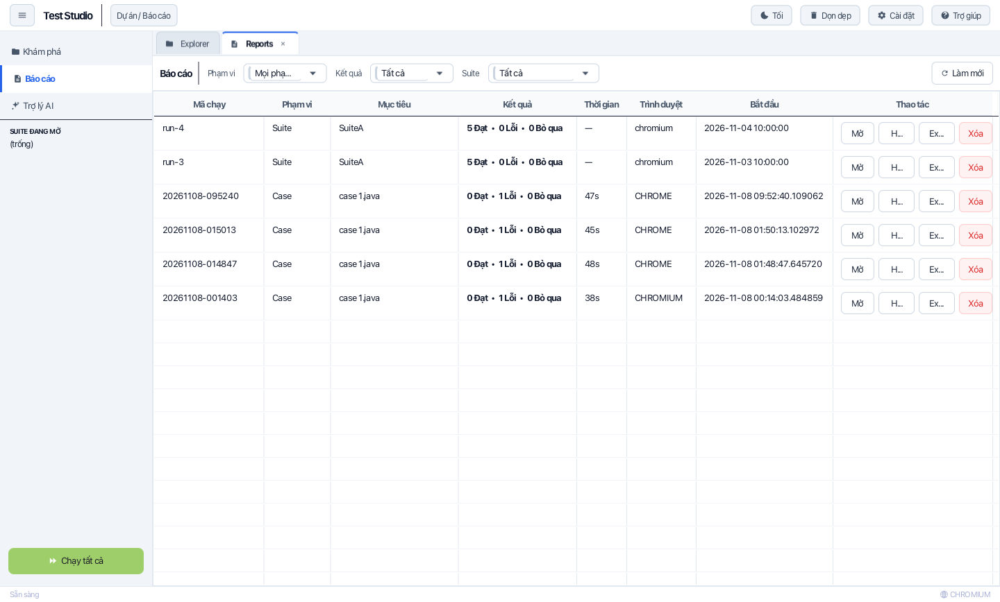

Cột: **Mã chạy**, **Phạm vi** (Case / Suite / Group / All), **Mục tiêu**, **Kết quả** (`x Đạt · y Lỗi · z Bỏ qua`), **Thời gian**, **Trình duyệt**, **Bắt đầu**, **Thao tác** (`Mở`, `Html`, `Excel`, `Xóa`). Bộ lọc phía trên: phạm vi, kết quả, suite; nút `Làm mới`.

### 8.2. Chi tiết lượt chạy

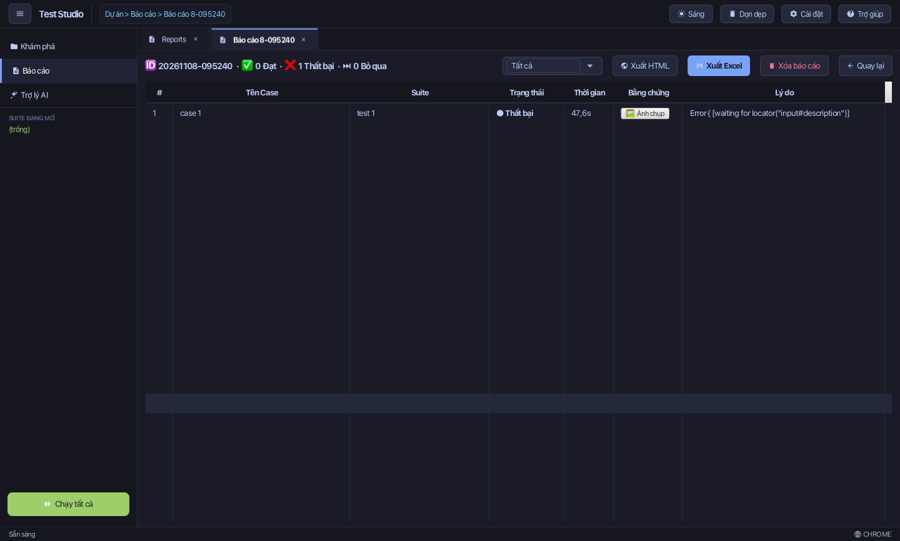

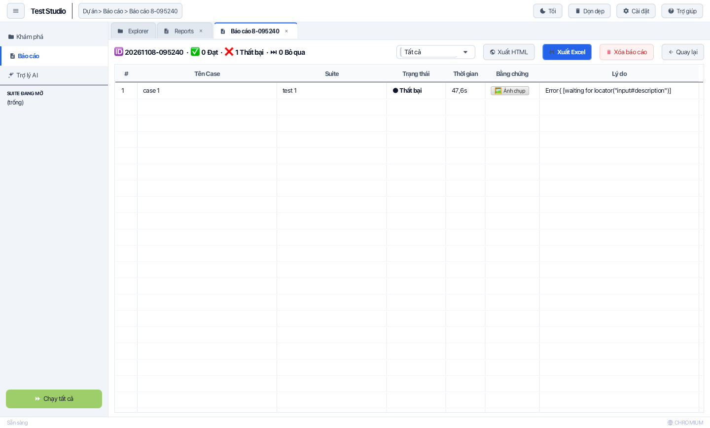

- **Tổng quan** kèm `Xuất HTML`, `Xuất Excel`, `Xóa báo cáo`, `Quay lại`; bộ lọc trạng thái.
- Bảng **Case**: tên, suite, trạng thái, thời gian, cột **Bằng chứng** (mở ảnh chụp), lý do lỗi.
- Chi tiết **assertion** theo từng case: đạt/sai/bỏ qua, giá trị mong đợi và giá trị thực tế.
- **Ảnh bằng chứng**: mỗi case đã chạy đều có ảnh `PASSED` hoặc `FAILED`, lưu ở `data/reports/<mã chạy>/screenshots/`. Mở ảnh bằng **trình xem bằng chứng** toàn màn hình (có phóng to và nút mở bằng ứng dụng ngoài).

### 8.3. Xuất báo cáo

| Định dạng | Nội dung |
|---|---|
| **HTML** | Một file tự chứa, ảnh nhúng Base64, bộ lọc đạt/sai tương tác, thẻ KPI, chi tiết assertion — gửi/nhận offline được |
| **Excel** | Workbook 3 sheet: `Summary`, `Cases`, `Asserts` |

File xuất mặc định nằm trong `data/exports/`; hộp thoại lưu cho phép chọn nơi khác. Báo cáo Excel có thể chọn **ngôn ngữ** (Việt / Anh) trước khi xuất.

### 8.4. Chuẩn đoán lỗi có cấu trúc & Các bước tái hiện

Báo cáo kiểm thử tự động loại bỏ stack trace kỹ thuật thô và thay thế bằng các thông tin trực quan:
- **Phân loại lỗi chuẩn hóa**:
  - `LocatorNotFound`: Không tìm thấy phần tử giao diện sau khi đã kích hoạt toàn bộ chiến lược tự phục hồi.
  - `Timeout`: Thao tác vượt quá ngưỡng thời gian chờ cấu hình.
  - `AssertionFailure`: Điều kiện khẳng định không thỏa mãn (ví dụ: văn bản không khớp, giá trị sai lệch).
  - `NavigationError` / `NetworkError`: Lỗi kết nối mạng, tải trang thất bại hoặc mã phản hồi HTTP lỗi.
- **Các bước tái hiện (Reproduction Steps)**: Tự động tổng hợp chuỗi thao tác dẫn đến thời điểm lỗi, giúp lập trình viên và QA tái hiện sự cố nhanh chóng.
- **Báo cáo đa định dạng**: Toàn bộ thông tin lỗi cấu trúc và bằng chứng ảnh chụp được tích hợp hoàn chỉnh trên cả file HTML độc lập và file Excel ISTQB.

---

## 9. Trợ lý AI

Mở bằng `Trợ lý AI` ở thanh bên.

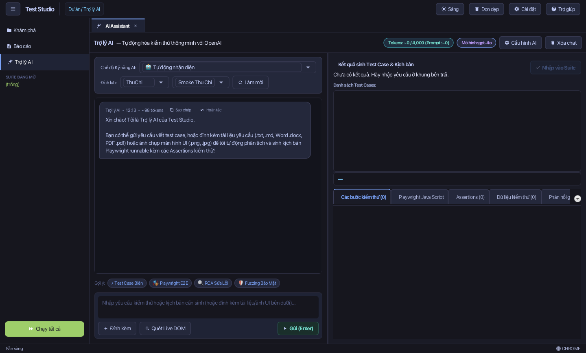

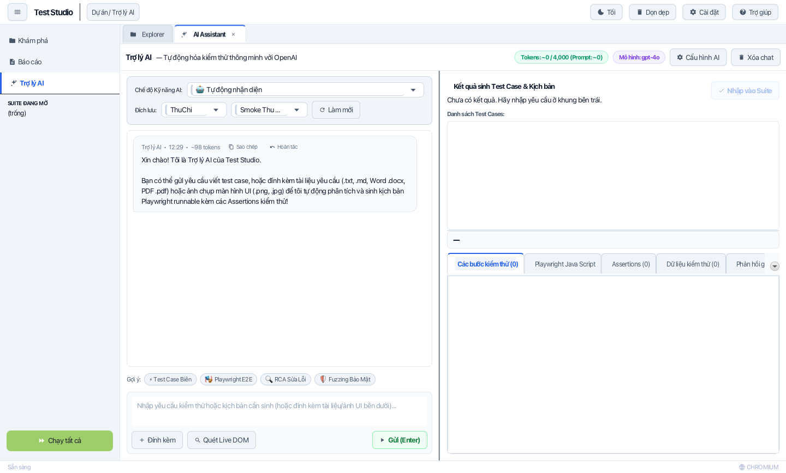

### 9.1. Bố cục

- **Cột trái — hội thoại**: *Chế độ kỹ năng*, **Đích lưu** (`Nhóm` + `Suite`, nút `Làm mới`), khung hội thoại có nút *Sao chép* / *Hoàn tác*, ô nhập yêu cầu, nút `+ Đính kèm`, `Quét Live DOM`, `▶ Gửi (Enter)` và các gợi ý nhanh (*Test Case Biên*, *Playwright E2E*, *RCA Sâu Lỗi*, *Fuzzing Bảo Mật*).
- **Cột phải — kết quả**: các tab `Các bước kiểm thử`, `Playwright Java Script`, `Assertions`, `Dữ liệu kiểm thử`, `Phản hồi` và nút **Nhập vào Suite**.
- **Chỉ số token** (góc trên): `Tokens: x/4.000 (Prompt: y)` và mô hình đang dùng; nút `Cấu hình AI`, `Xóa chat`.

### 9.2. Quy trình sinh test case

1. Mở **Cài đặt** → tab AI, nhập API key, endpoint và mô hình (mục [10.2](#102-cấu-hình-ai)).
2. Ở Trợ lý AI, chọn nơi lưu case, mô tả kịch bản cần kiểm thử.
3. (Tuỳ chọn) Đính kèm tài liệu nghiệp vụ hoặc ảnh mockup — hỗ trợ `.txt`, `.md`, `.json`, `.csv`, `.docx`, `.pdf`, `.png`, `.jpg`.
4. Gửi yêu cầu (`Enter` hoặc `Ctrl/Cmd + Enter`).
5. Xem trước các tab kết quả, chỉnh nếu cần, rồi bấm **Nhập vào Suite** để tạo case và kịch bản.

### 9.3. Hộp thoại Sinh Test Case Trực quan (AiCasePromptDialog)

Bấm nút **✨ AI Hỗ trợ** trong thanh hành động Workspace (hoặc tạo ca kiểm thử mới từ prompt) để mở hộp thoại `AiCasePromptDialog`:
- Nhập mô tả kịch bản kiểm thử bằng ngôn ngữ tự nhiên (tiếng Việt hoặc tiếng Anh).
- Tùy chọn đội ngũ chuyên gia AI chuyên sâu (Agency-Agents Roster) phù hợp với mục tiêu kiểm thử:
  - 🎭 **QA Architect**: Thiết kế kịch bản chuẩn Playwright E2E, bao quát luồng nghiệp vụ chính (Happy Path).
  - 🛡️ **Security Specialist**: Kiểm thử bảo mật giao diện, form injection, phân quyền, dữ liệu nhạy cảm.
  - 🔬 **Edge-case Analyst**: Tìm kiếm các trường hợp biên, giá trị cực đại/cực tiểu, luồng hủy ngang và dữ liệu lỗi.
  - 📊 **Test Data Engineer**: Xây dựng ma trận bộ dữ liệu kiểm thử (Test Data Schema) đa dạng.
- **Bộ phân tích phản hồi 3 tầng siêu bền bỉ (3-Tier Robust Parser)**:
  - *Tier 1*: Phân tích cấu trúc JSON chuẩn.
  - *Tier 2*: Tự động bóc tách từ khối Markdown code block / fenced block.
  - *Tier 3*: Tự vá lỗi bằng biểu thức chính quy (Regex Repair) khi model trả về định dạng khiếm khuyết.
- Tự động sinh trọn bộ: Mã Playwright Java chạy được ngay + Ma trận dữ liệu mẫu + Danh sách bước NLP tương ứng.

### 9.4. Quét Live DOM

Nút **Quét Live DOM** trích xuất cấu trúc trang đang chạy để AI chọn locator ổn định thay vì đoán theo ảnh.

### 9.5. Bộ chuyển đổi tài liệu hybrid MarkItDown (Multi-Format Document Ingestion)

Trợ lý AI tích hợp bộ chuyển đổi tài liệu đa định dạng `MarkdownConverterEngine`:
- Hỗ trợ nhập tài liệu đặc tả yêu cầu, tài liệu nghiệp vụ từ định dạng Word (`.docx`), PDF (`.pdf`), Excel (`.xlsx`), PowerPoint (`.pptx`), và HTML.
- Tự động trích xuất và chuẩn hóa văn bản thành Markdown cấu trúc cao để đưa vào ngữ cảnh prompt AI mà không làm tràn giới hạn token.

---

## 10. Cài đặt, dọn dẹp dữ liệu & chủ đề

### 10.1. Hộp thoại Cài đặt

Mở bằng nút **Cài đặt** (⚙) ở góc trên phải — một hộp thoại dạng tab:

- **Tab Chung**: trình duyệt mặc định, chế độ ẩn, chia sẻ context, dừng khi lỗi, xuất/nhập file cấu hình.
- **Tab AI**: API key, Base URL, mô hình, temperature, nút **Kiểm tra kết nối** (đo độ trễ).

### 10.2. Cấu hình AI

| Trường | Ví dụ |
|---|---|
| API key | `sk-…` — lưu dạng mã hoá (`ApiKeyCipher`), có thể dùng biến môi trường `OPENAI_API_KEY` |
| Base URL | `https://api.openai.com/v1` hoặc nhà cung cấp tương thích: OpenRouter, DeepSeek, Groq, Gemini, Ollama/LocalAI, Azure |
| Model | Danh sách gợi ý tự đổi theo Base URL (`gpt-4o`, `deepseek-chat`, `llama3.2` khi chạy local…) |

### 10.3. Dọn dẹp dữ liệu

Nút **Dọn dẹp** mở hộp thoại quản lý dung lượng: xem dung lượng và xoá báo cáo cũ, ảnh bằng chứng, log, cache chỉ mục H2 — chỉ xoá khi bạn xác nhận.

### 10.4. Chủ đề

Nút **Sáng/Tối** đổi giao diện tức thời (không cần khởi động lại) và lưu lựa chọn. Hai stylesheet: `css/studio.css` (tối, Catppuccin Mocha) và `css/studio-light.css` (sáng); hộp thoại và popup cũng áp cùng chủ đề.

---

## 11. Ngăn trợ giúp trong ứng dụng

### 11.1. Tóm tắt thao tác nhanh

Nút **Trợ giúp** (❓) mở ngăn bên phải (khoảng 2/3 chiều rộng) — bản tóm tắt thao tác dùng ngay trong lúc làm việc:

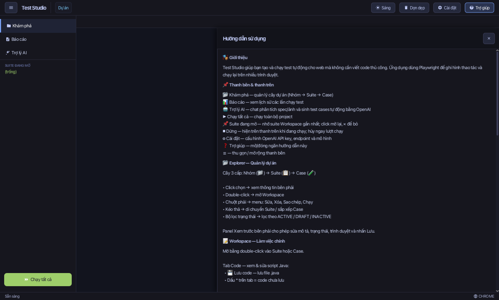

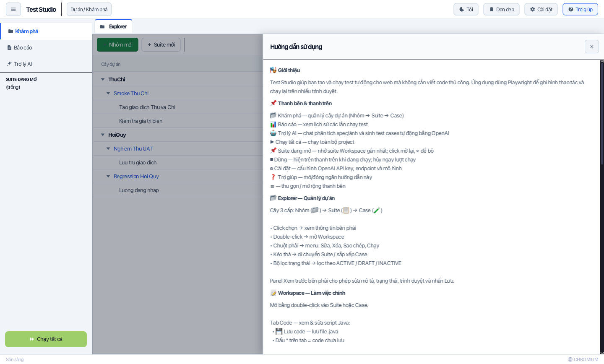

Các mục: Giới thiệu · Thanh bên & thanh trên · Explorer · Workspace · Ghi hình · Chạy test · Assertion Builder · Báo cáo & xuất Excel · Mẹo nhanh. Bấm ra ngoài hoặc `✕` để đóng.

### 11.2. Trình xem Hướng dẫn Sử dụng Tích hợp (In-App User Guide Viewer)

Trong ngăn Trợ giúp (Help Drawer), bấm nút **"Xem toàn bộ hướng dẫn"** để mở trình duyệt cẩm nang người dùng:
- Hiển thị toàn bộ hướng dẫn sử dụng Markdown ngay bên trong giao diện ứng dụng mà không cần mở trình duyệt web bên ngoài.
- **Hỗ trợ song ngữ**: Chuyển đổi linh hoạt giữa Tiếng Việt và English.
- **Mục lục điều hướng nhanh (TOC)**: Nhấp chuột vào bất kỳ đề mục nào để cuộn ngay đến phần tương ứng.
- **Ảnh chụp giao diện theo chủ đề**: Toàn bộ ảnh chụp màn hình minh họa tự động hiển thị theo chủ đề Sáng hoặc Tối (Catppuccin Mocha) và được nhúng sẵn ngoại tuyến trong ứng dụng.

---

## 12. Chạy trên dòng lệnh, đóng gói & tích hợp CI

### 12.1. Đóng gói bộ cài đặt ngoại tuyến (Offline Installers)

Ứng dụng hỗ trợ đóng gói đầy đủ JRE 26, Node.js LTS, Playwright CLI và Chromium offline:

| Hệ điều hành | Định dạng | Lệnh đóng gói | Đặc điểm |
|---|---|---|---|
| **macOS** | `.dmg` | `./scripts/build-installer.sh` | File cài đặt kéo-thả vào Applications (hỗ trợ Apple Silicon ARM64 và Intel x64) |
| **Windows** | Setup `.exe` | `scripts\build-installer.bat` | Bộ cài Wizard Inno Setup với shortcut Desktop, Start Menu và trình gỡ cài đặt |
| **Multi-platform** | `.zip` (Portable) | `scripts/build-portable.sh` / `.bat` | Thư mục ứng dụng portable tự chứa, chạy trực tiếp không cần cài đặt |

### 12.2. Lệnh dòng lệnh cục bộ

```bash
mvn -q -DskipTests compile      # Biên dịch mã nguồn
mvn test                        # Chạy toàn bộ 260 unit & integration test
bash scripts/build-installer.sh # Đóng gói DMG cho macOS
scripts\build-installer.bat     # Đóng gói Windows Setup (.exe)
```

### 12.3. Tự động hóa CI/CD (GitHub Actions)

- `ci.yml` — Biên dịch và chạy bộ test khi push/PR lên nhánh `main`.
- `release-portable.yml` — Đóng gói bản Portable đa nền tảng (macOS, Windows, Linux) khi gắn tag release `v*`.
- `build-installers.yml` — Tự động build bộ cài đặt ngoại tuyến (macOS `.dmg` & Windows Setup `.exe`) khi phát hành phiên bản mới.

---

## 13. Cấu trúc dữ liệu & đường dẫn

### 13.1. Thư mục dữ liệu

`APP_HOME` được xác định theo thứ tự:

1. `-Dstudio.home=/path`
2. Biến môi trường `STUDIO_HOME`
3. Thư mục cha của file JAR (bản portable)
4. Thư mục làm việc hiện tại (bản dev)

Dữ liệu nằm ở `APP_HOME/data`; override bằng `-Dstudio.data.dir` hoặc `STUDIO_DATA_DIR` (hữu ích khi ứng dụng nằm ở vị trí chỉ đọc như `/Applications`):

```
data/
├── config/settings.json      # browser, theme, aiConfig (API key đã mã hoá)
├── project/                  # cây Nhóm → Suite → Case
│   └── <Nhóm>/group.json
│       └── <Suite>/suite.json + <Case>.java
├── reports/<mã chạy>/report.json + screenshots/
├── exports/                  # đích mặc định khi xuất Excel/HTML
└── logs/ai.log
```

### 13.2. Định dạng `suite.json`

```json
{
  "name": "Smoke Thu Chi",
  "status": "ACTIVE",
  "description": "Bộ kiểm thử khói",
  "browser": "",
  "headless": false,
  "cases": [
    {
      "id": "tc-3c7bb1ab",
      "name": "Tao giao dich Thu va Chi",
      "scriptFile": "TaoGiaoDich.java",
      "status": "Ready",
      "startUrl": "https://example.com",
      "assertions": [
        { "type": "PAGE_HAS_TEXT", "value": "Lương tháng 10", "status": "ACTIVE",
          "exact": false, "timeoutMs": 30000, "locator": "" }
      ],
      "testSteps": [ { "stepNumber": 1, "action": "NAVIGATE", "target": "https://example.com" } ]
    }
  ]
}
```

- `browser` rỗng = dùng trình duyệt mặc định trong Cài đặt (mặc định Playwright Chromium).
- `status` của Suite: `DRAFT` | `ACTIVE` | `INACTIVE`; của Case: `Draft` | `Ready` | `Inactive`.
- `testSteps` / `testDataSets` do Trợ lý AI điền và dùng cho quản lý dữ liệu kiểm thử; lượt chạy dùng file `.java` của case.

### 13.3. Tự sửa locator (self-healing)

Kịch bản sinh ra gọi `StudioRuntime.healLocator(selector, mô tả)`. Khi selector không tìm thấy, runtime thử lần lượt các chiến lược thay thế (thuộc tính, văn bản, vị trí) và ghi lại bước đã tự sửa để xem trong report. Thiết kế chi tiết: [docs/SELF_HEALING_DESIGN.md](../SELF_HEALING_DESIGN.md).

---

## 14. Mẹo sử dụng

- Double-click Suite để mở Workspace; click **SUITE ĐANG MỞ** ở thanh bên để mở lại sau khi chuyển trang (nút ✕ để bỏ).
- Dùng **Chung context** khi các case phụ thuộc phiên đăng nhập; tắt để cô lập trạng thái.
- Đặt tên case theo hành vi (`Tao giao dich Thu va Chi`) — tên xuất hiện xuyên suốt report, HTML và Excel.
- Trước khi chạy hồi quy: chuyển Suite sang `ACTIVE`, kiểm tra case `Ready` và có ít nhất một assertion `ACTIVE`.
- Code chưa lưu → nhãn `● Chưa lưu` trên khung code; chuyển case sẽ hỏi xác nhận.
- Terminal tự hiện khi ghi hình/chạy; nút `Ẩn` để đóng, `Xóa log` để dọn.

---

## 15. Xử lý sự cố

| Hiện tượng | Nguyên nhân thường gặp | Cách xử lý |
|---|---|---|
| `Ghi hình` không mở trình duyệt | Thiếu Node.js / Playwright CLI ở bản dev | Cài Node 20+, chạy `npx playwright install`; bản portable đã kèm sẵn |
| Case bị bỏ qua khi chạy | Suite chưa `ACTIVE`, case chưa `Ready`, hoặc thiếu assertion `ACTIVE` | Sửa trạng thái / thêm assertion rồi chạy lại |
| `Timeout 30000ms exceeded` | Locator không còn đúng sau thay đổi UI | Sửa locator trong Assertion Builder hoặc kịch bản; tăng `Timeout` khi trang chậm |
| Ảnh bằng chứng thiếu | Lượt chạy bị huỷ trước khi case kết thúc | Xem log trong report; chạy lại case |
| Trợ lý AI báo lỗi kết nối | API key / Base URL / mô hình chưa đúng | `Cài đặt → Kiểm tra kết nối` để xem độ trễ và thông báo |
| Ứng dụng nặng dần sau nhiều lượt chạy | Log/ảnh/cache tích tụ | Dùng **Dọn dẹp**; ứng dụng cũng tự nhả bộ nhớ khi thu nhỏ cửa sổ |

---

## 16. Câu hỏi thường gặp

**Có cần biết lập trình Java không?** Không. Ghi hình sinh kịch bản, assertion thêm bằng giao diện; biết Java giúp xử lý trường hợp đặc biệt.

**Một case có thể gồm nhiều bước?** Có — mỗi case là một kịch bản nhiều bước; assertion kiểm tra kết quả ở cuối hoặc bất kỳ điểm nào trong luồng.

**Report lưu ở đâu sau khi đóng ứng dụng?** Trong `data/reports/<mã chạy>` — mở lại bất cứ lúc nào ở trang Báo cáo.

**Có thể đưa dự án lên Git không?** Có. `data/project` và `data/reports` mặc định nằm trong `.gitignore`; bỏ các dòng tương ứng nếu muốn chia sẻ test.

**Có chạy được trên máy không có JDK?** Có, với gói portable hoặc bộ cài (kèm JRE).

---

## Tài liệu liên quan

| Tài liệu | Nội dung |
|---|---|
| [README.md](../../README.md) | Tổng quan nhanh, tính năng, cấu hình |
| [docs/BUILD.md](../BUILD.md) | Hướng dẫn build và đóng gói |
| [docs/ARCHITECTURE.md](../ARCHITECTURE.md) | Kiến trúc, luồng dữ liệu, cấu trúc package |
| [docs/RELEASE_NOTES.md](../RELEASE_NOTES.md) | Ghi chú phát hành |
| [CHANGELOG.md](../../CHANGELOG.md) | Lịch sử thay đổi |
