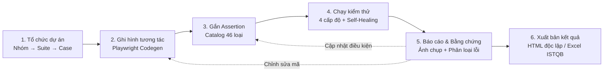
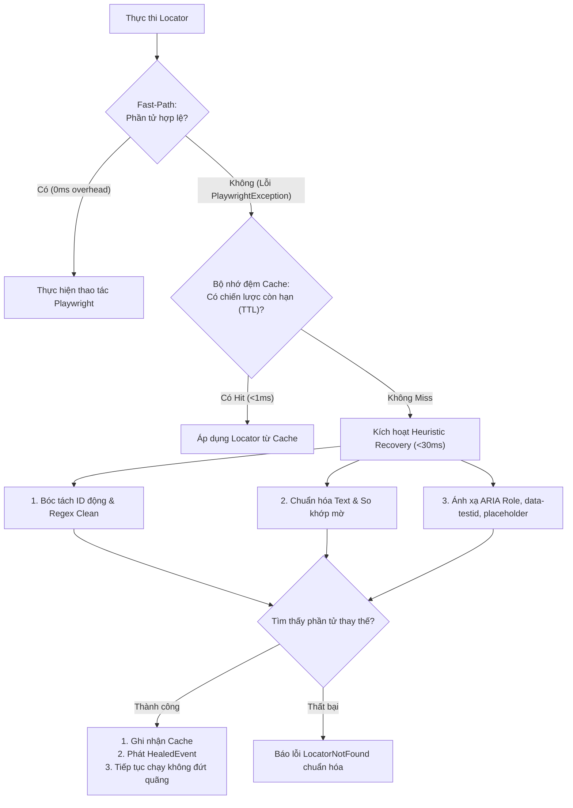
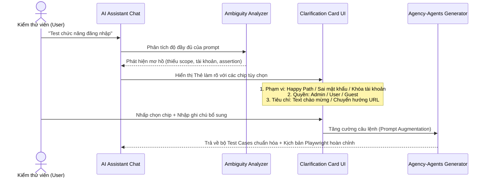
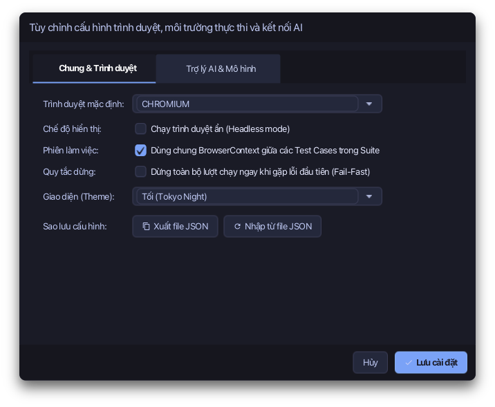
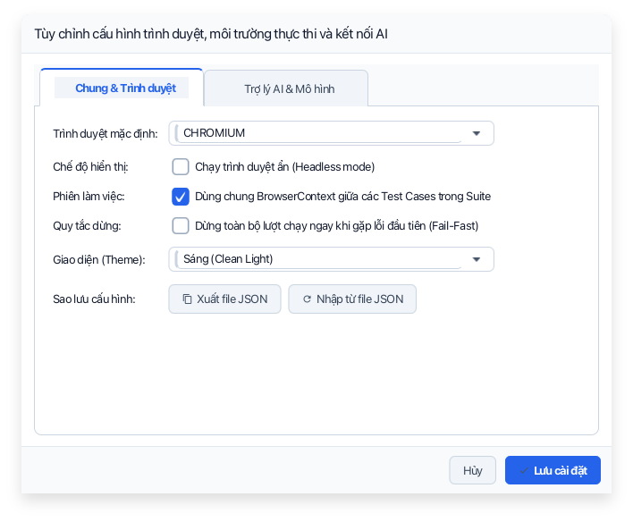
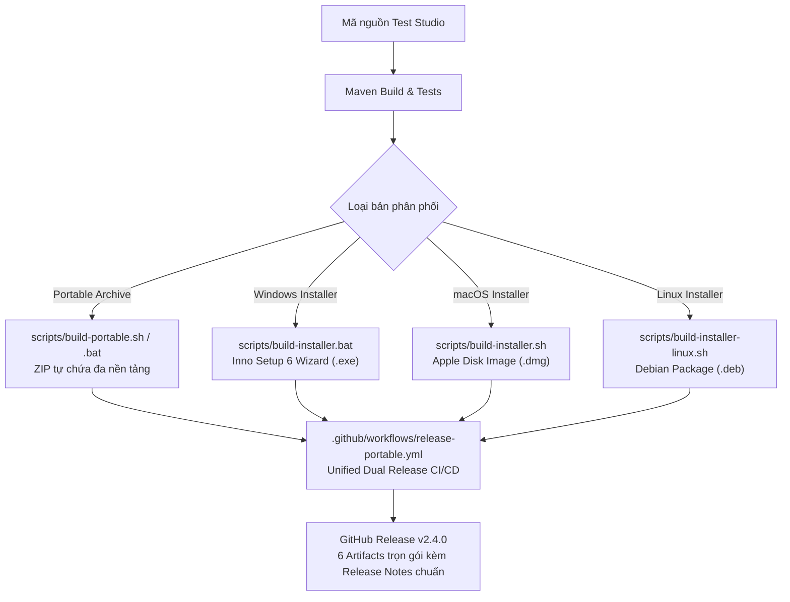

# Hướng dẫn sử dụng Test Studio (User Guide)

> Ứng dụng desktop JavaFX chuyên nghiệp giúp **ghi hình, tổ chức, tự phục hồi và chạy tự động** kiểm thử web bằng Playwright — không đòi hỏi viết code thủ công.

---

> 🌐 **Ngôn ngữ / Language:** **Tiếng Việt (Hiện tại)** · [English Guide (Bản tiếng Anh)](USER_GUIDE_EN.md)

Bộ tài liệu này phản ánh **chính xác trạng thái thực tế của phiên bản mới nhất** (nhánh `main`). Toàn bộ hình ảnh minh họa được trích xuất trực tiếp từ giao diện thực tế của ứng dụng với dữ liệu mẫu hoàn chỉnh.

| Thông số | Giá trị |
|---|---|
| **Phiên bản (Version)** | **2.4.0** (`pom.xml`) |
| **Nền tảng (Platform)** | JavaFX 26.0.1 · Playwright Java 1.61.0 · OpenJDK 26+ · Node.js 20+ LTS |
| **Chủ đề giao diện (Themes)** | Tối (**Catppuccin Mocha**) / Sáng (**Modern Light**) — chuyển tức thời |
| **Bộ cài đặt (Installers)** | Windows Setup (`.exe`), macOS Disk Image (`.dmg`), Linux Debian (`.deb`), Portable (`.zip`) |
| **Trợ lý AI & Cố vấn (AI Core)** | OpenAI (GPT-4o, o3-mini) / Ollama / LocalAI / DeepSeek / Azure OpenAI |

---

## Mục lục

1. [Giới thiệu tổng quan](#1-giới-thiệu-tổng-quan)
2. [Cài đặt & Khởi chạy](#2-cài-đặt--khởi-chạy)
3. [Giao diện tổng quan & Bảng phím tắt](#3-giao-diện-tổng-quan--bảng-phím-tắt)
4. [Explorer — Quản lý cây dự án](#4-explorer--quản-lý-cây-dự-án)
5. [Tạo và cấu hình Nhóm / Suite / Case](#5-tạo-và-cấu-hình-nhóm--suite--case)
6. [Workspace — Ghi hình, Soạn thảo & Chạy kiểm thử](#6-workspace--ghi-hình-soạn-thảo--chạy-kiểm-thử)
7. [Động cơ tự phục hồi locator (Optimized Self-Healing)](#7-động-cơ-tự-phục-hồi-locator-optimized-self-healing)
8. [Assertion Builder — Catalog 46 loại kiểm tra](#8-assertion-builder--catalog-46-loại-kiểm-tra)
9. [Báo cáo, Bằng chứng & Phân loại lỗi chuẩn hóa](#9-báo-cáo-bằng-chứng--phân-loại-lỗi-chuẩn-hóa)
10. [Trợ lý AI, Thẻ làm rõ & Cố vấn dự án đàm thoại](#10-trợ-lý-ai-thẻ-làm-rõ--cố-vấn-dự-án-đàm-thoại)
11. [Cài đặt, Dọn dẹp dữ liệu & Quản lý chủ đề](#11-cài-đặt-dọn-dẹp-dữ-liệu--quản-lý-chủ-đề)
12. [Ngăn trợ giúp & Trình xem tài liệu tích hợp](#12-ngăn-trợ-giúp--trình-xem-tài-liệu-tích-hợp)
13. [Đóng gói bộ cài đặt ngoại tuyến & Tích hợp CI/CD](#13-đóng-gói-bộ-cài-đặt-ngoại-tuyến--tích-hợp-cicd)
14. [Cấu trúc dữ liệu & Đặc tả lưu trữ](#14-cấu-trúc-dữ-liệu--đặc-tả-lưu-trữ)
15. [Mẹo tối ưu & Thực hành tốt nhất](#15-mẹo-tối-ưu--thực-hành-tốt-nhất)
16. [Xử lý sự cố & Câu hỏi thường gặp (FAQ)](#16-xử-lý-sự-cố--câu-hỏi-thường-gặp-faq)

---

## 1. Giới thiệu tổng quan

**Test Studio** là giải pháp kiểm thử web tự động hoá All-in-One: bạn tương tác trực quan trên trình duyệt thật, **Playwright Codegen** tự động ghi nhận thành kịch bản mã nguồn Java, bạn gắn thêm các điều kiện kiểm tra (assertions) thông qua giao diện trực quan và chạy lại bất kỳ lúc nào — theo từng ca kiểm thử lẻ, từng bộ kiểm thử (Suite), hay toàn bộ dự án.



### Các ưu điểm vượt trội

- **Kiến trúc thực thi In-Process JVM**: Kịch bản kiểm thử được biên dịch động và chạy ngay trong JVM ứng dụng thông qua `JavaCompiler` và `URLClassLoader`, không phụ thuộc CLI rời, không mở terminal phụ.
- **Chia sẻ phiên trình duyệt (Shared Browser Context)**: Duy trì trạng thái đăng nhập, Cookie và `localStorage` liên tục qua các case mà không cần đăng nhập lại từ đầu.
- **Động cơ tự phục hồi thông minh (Self-Healing)**: Tự động phát hiện và khắc phục các locator bị vỡ do ID động hay cấu trúc DOM thay đổi trong thời gian dưới 30ms.
- **Trợ lý AI & Cố vấn đàm thoại v2.3**: Phân tích tài liệu đặc tả nghiệp vụ, đặt câu hỏi làm rõ qua thẻ tương tác trực quan, kiểm toán chất lượng kịch bản (xếp hạng A-D) và phát hiện khoảng trống kiểm thử.
- **Báo cáo chuẩn hóa ISTQB/IEEE 829**: Loại bỏ stack trace thô; tự động trích xuất chuỗi bước tái hiện và bằng chứng ảnh chụp toàn màn hình độ phân giải cao.

---

## 2. Cài đặt & Khởi chạy

### 2.1. Yêu cầu môi trường

| Thành phần | Phiên bản | Ghi chú bắt buộc |
|---|---|---|
| **JDK** | **26 trở lên** | Khuyến nghị Eclipse Temurin. Trình biên dịch `javac` bắt buộc phải có mặt. |
| **Maven** | **3.9+** | Chỉ yêu cầu khi biên dịch và chạy từ mã nguồn. |
| **Node.js** | **20+ LTS** | Bắt buộc cho tính năng Ghi hình (Codegen) ở chế độ dev. Bản Portable/Installer đã tích hợp sẵn. |

### 2.2. Khởi chạy từ mã nguồn

```bash
git clone https://github.com/tranquoc/GUI-test-tool.git
cd GUI-test-tool
mvn javafx:run
```

> [!NOTE]
> Khi khởi chạy lần đầu tiên, Test Studio tự động khởi tạo cấu trúc thư mục lưu trữ cục bộ tại `data/project`, `data/config` và `data/reports`. Nếu chưa có dữ liệu, hãy bắt đầu bằng nút **+ Nhóm mới**.

### 2.3. Bản phân phối Portable (Không cần cài đặt)

```bash
# macOS / Linux
bash scripts/build-portable.sh

# Windows
scripts\build-portable.bat
```

Gói portable được xuất ra thư mục `dist/`, tích hợp sẵn JRE 26, Node.js LTS, Playwright CLI và Chromium offline. Người dùng cuối chỉ cần giải nén và nhấp đúp vào `run.sh` hoặc `run.bat` để chạy ngay mà không cần cài đặt thêm bất kỳ phần mềm nào.

### 2.4. Chủ đề Tối và Sáng linh hoạt

Test Studio hỗ trợ 2 bộ giao diện hoàn chỉnh:
- **Chủ đề Tối (Mặc định)**: Bảng màu chuẩn **Catppuccin Mocha** êm mắt, độ tương phản cao, tối ưu cho lập trình viên và QA.
- **Chủ đề Sáng**: Bảng màu tươi sáng, sắc nét, thích hợp môi trường văn phòng nhiều ánh sáng.

Chuyển đổi tức thì thông qua nút **Sáng / Tối** tại góc trên bên phải màn hình — giao diện cập nhật ngay lập tức mà không cần khởi động lại.

---

## 3. Giao diện tổng quan & Bảng phím tắt

### 3.1. Bố cục 4 phân vùng chính

**Chủ đề Tối (Mặc định):**


**Chủ đề Sáng:**


| Phân vùng | Mô tả chức năng |
|---|---|
| **Thanh điều hướng bên trái** (Sidebar, 220px / thu gọn 56px) | Chuyển đổi giữa `Khám phá (Explorer)`, `Báo cáo (Reports)`, `Trợ lý AI (AI Assistant)`; hiển thị khối `SUITE ĐANG MỞ` và nút `Chạy tất cả`. |
| **Thanh Tab đa nhiệm** (Document Tabs) | Quản lý đồng thời nhiều Suite, Báo cáo và Trợ lý AI đang mở; theo dõi trạng thái chưa lưu (`● Chưa lưu`) và hỗ trợ đóng nhanh tab `✕`. |
| **Thanh Breadcrumb** (`Dự án > ...`) | Định vị theo ngữ cảnh thời gian thực: `Dự án > Nhóm > Suite > Case` giúp người dùng luôn nắm rõ vị trí làm việc. |
| **Thanh trạng thái đáy** (Status Bar) | Hiển thị trạng thái máy học (`Sẵn sàng`, `Đang chạy...`, `Đang ghi hình...`), trình duyệt kích hoạt và tiến trình ngầm. |

Các nút chức năng góc trên bên phải:
- **Sáng / Tối**: Hoán đổi theme runtime.
- **Dọn dẹp**: Mở hộp thoại giải phóng dung lượng báo cáo, cache và ảnh bằng chứng.
- **Cài đặt (⚙)**: Cấu hình trình duyệt mặc định, tham số chạy và API Key AI.
- **Trợ giúp (❓)**: Mở ngăn cẩm nang trợ giúp nhanh bên phải.
- **⏹ Dừng**: Tự động xuất hiện khi có lượt chạy kiểm thử đang diễn ra để dừng khẩn cấp.

> [!TIP]
> **Hệ thống thông báo Toast (Toast Notification)**: Mọi thao tác người dùng (tạo/sửa/xóa, ghi hình, chạy test, xuất file) đều phát tín hiệu phản hồi tức thì ở góc dưới bên phải màn hình với 4 mức màu: Thành công (Xanh lá), Thông tin (Xanh dương), Cảnh báo (Vàng) và Lỗi (Đỏ).

### 3.2. Bảng phím tắt & Thao tác nhanh (Cheat Sheet)

| Thao tác | Phím tắt / Hành động | Ngữ cảnh |
|---|---|---|
| **Lưu kịch bản mã nguồn** | `Ctrl + S` (Win/Linux) hoặc `Cmd + S` (macOS) | Suite Workspace (Code Editor) |
| **Gửi câu lệnh / Tin nhắn AI** | `Enter` hoặc `Ctrl/Cmd + Enter` | Khung hội thoại AI Assistant |
| **Đóng hộp thoại modal** | `Esc` | Hộp thoại Cài đặt, Form, Assert Builder |
| **Mở nhanh Suite Workspace** | Nhấp đúp chuột (**Double Click**) vào Suite | Explorer Tree |
| **Mở menu thao tác nhanh** | Nhấp chuột phải (**Right Click**) vào nút cây | Explorer Tree |
| **Chạy kiểm thử nhanh** | Nhấp biểu tượng `▶` trên dòng cây hoặc bảng case | Explorer / Workspace |
| **Đổi chế độ xem Code / Assert** | Nhấp nút `[◫ Chia đôi]` hoặc `[🗖 Toàn màn hình]` | Suite Workspace |

---

## 4. Explorer — Quản lý cây dự án

Explorer tổ chức toàn bộ tài sản kiểm thử theo mô hình phân cấp 3 tầng chặt chẽ: `Nhóm (Group) → Bộ kiểm thử (Suite) → Ca kiểm thử (Case)`.


### 4.1. Cấu trúc và Vùng xem trước

- **Cột cây bên trái (Project Tree)**: Hiển thị danh mục lồng nhau. Mỗi mục đều gắn huy hiệu trạng thái trực quan:
  - `● Hoạt động` (`ACTIVE` / `Ready`): Sẵn sàng thực thi.
  - `● Nháp` (`DRAFT` / `Draft`): Đang xây dựng, tự động bỏ qua khi chạy hàng loạt.
  - `● Ngừng` (`INACTIVE` / `Inactive`): Tạm ngưng áp dụng.
- **Thanh công cụ lọc (Filter Toolbar)**: Nút `+ Nhóm mới`, `+ Suite mới`, ô tìm kiếm theo tên và các chip lọc trạng thái nhanh (`[Tất cả]`, `[Hoạt động]`, `[Nháp]`, `[Ngừng]`).
- **Khung Xem trước bên phải (Preview Pane)**: Khi chọn bất kỳ mục nào trên cây, khung bên phải hiển thị chi tiết metadata: tên, mô tả, trạng thái hoạt động, thống kê số lượng con và nút **Sửa / Xóa** trực tiếp.

### 4.2. Thao tác trên cây

| Thao tác | Hướng dẫn thực hiện |
|---|---|
| **Chọn mục** | Nhấp chuột một lần. Bảng xem trước cập nhật ngay tức thì. Nhấp lại để bỏ chọn. |
| **Mở Suite** | Nhấp đúp vào Suite để mở một tab Workspace riêng biệt trên thanh Tab. |
| **Menu ngữ cảnh** | Chuột phải để hiển thị menu: `Sửa`, `Sao chép`, `Xóa`, `Chạy`. |
| **Thao tác lơ lửng (Hover Actions)** | Rê chuột lên hàng bất kỳ để hiện các nút bấm nhanh: `[▶ Chạy]`, `[+ Thêm]`, `[✏️ Sửa]`, `[📋 Sao chép]`, `[🗑️ Xóa]`. |
| **Kéo-thả sắp xếp (Drag & Drop)** | Kéo Suite chuyển sang Nhóm khác hoặc kéo để thay đổi thứ tự thực thi. |

> [!IMPORTANT]
> Toàn bộ cấu trúc thư mục và tập tin được đồng bộ trực tiếp với ổ đĩa (`data/project`). Mọi thay đổi tập tin từ bên ngoài (như git checkout hay sửa file JSON thủ công) đều được ứng dụng tự động tải lại khi làm mới cây.

---

## 5. Tạo và cấu hình Nhóm / Suite / Case

Bấm **+ Nhóm mới**, **+ Suite mới** tại Explorer hoặc **+ Case mới** trong Workspace để mở biểu mẫu cấu hình chuyên dụng.

| Tạo Nhóm mới (Tối) | Tạo Case mới (Tối) |
|---|---|
|  |  |

| Tạo Nhóm mới (Sáng) | Tạo Case mới (Sáng) |
|---|---|
|  |  |

### 5.1. Bảng trường thông tin cấu hình

| Cấp | Trường bắt buộc | Trường tùy chọn | Ý nghĩa kỹ thuật |
|---|---|---|---|
| **Nhóm** | Tên nhóm | Mô tả | Thư mục vật lý nhóm các bài kiểm thử liên quan. |
| **Suite** | Tên suite | Mô tả, Trạng thái, Trình duyệt, Chạy ẩn (`Headless`) | Bộ kịch bản kiểm thử dùng chung ngữ cảnh. Trạng thái `ACTIVE` mới được phép chạy. |
| **Case** | Tên case | Mô tả, Trạng thái, **URL bắt đầu**, Trình duyệt, Chạy ẩn | Kịch bản kiểm thử đơn lẻ (`.java`). URL bắt đầu là địa chỉ đích mở trình duyệt. |

### 5.2. Tính năng Lưu và Ghi hình ngay (Save & Record)

Khi tạo Case mới, bạn có thể nhập URL bắt đầu rồi bấm nút **Lưu và ghi**:
1. Hệ thống lưu metadata case vào `suite.json`.
2. Tạo tập tin mã nguồn `.java` khung.
3. Lập tức khởi chạy Playwright Codegen mở trình duyệt tương ứng tới đúng URL đích.

---

## 6. Workspace — Ghi hình, Soạn thảo & Chạy kiểm thử

Workspace là môi trường làm việc tập trung mô phỏng Pro-IDE (tương tự VS Code / IntelliJ) giúp kiểm thử viên thao tác mượt mà giữa mã nguồn, assertions và terminal.


### 6.1. Bố cục phân vùng Workspace

1. **Cột danh sách Case (Trái)**: Liệt kê các case trong suite hiện tại, ô tìm kiếm nhanh, nút `+ Case mới` và nút `▶` chạy riêng từng case.
2. **Thanh tác vụ tập trung (Top Action Bar)**: Gồm tiêu đề Case, nhãn trạng thái, ô URL bắt đầu, `[🔴 Ghi hình]`, `[▶ Chạy case]`, `[▶ Chạy suite]`, `[✨ AI Hỗ trợ]`, `[💾 Lưu code]`, `[Xuất Excel]`, nút bố cục `[Chia đôi]` và tùy chọn `Dừng khi lỗi` / `Chung context`.
3. **Trình soạn thảo mã (Center Code Editor)**: Soạn thảo mã Java Playwright với đánh dấu cú pháp; nhãn cảnh báo `● Chưa lưu` xuất hiện khi có chỉnh sửa.
4. **Cột quản lý Assertions (Phải)**: Danh sách kiểm tra của case, bộ lọc 8 danh mục và nút `+ Quản lý Asserts`.
5. **Cửa sổ Terminal (Dưới cùng)**: Tự động trượt lên khi ghi hình hoặc chạy test để hiển thị stdout/stderr thời gian thực.

### 6.2. Quy trình Ghi hình kịch bản (Playwright Codegen)

1. Chọn ca kiểm thử cần ghi hình ở cột trái.
2. Nhập URL trang web đích vào ô URL (ví dụ: `https://example.com/login`).
3. Bấm nút **🔴 Ghi hình** → Playwright Codegen kích hoạt mở trình duyệt sạch (Chromium/Firefox/WebKit).
4. Thực hiện các thao tác người dùng (nhập liệu, click chuột, chọn dropdown, cuộn trang).
5. **Đóng cửa sổ trình duyệt** → Kịch bản tương tác được tự động chuyển đổi thành mã Java Playwright chuẩn mực và ghi xuống file `.java`.
6. Hộp thoại **Assertion Builder** tự động mở ra để bạn thiết lập tiêu chí Pass/Fail.

### 6.3. Bốn cấp độ thực thi kiểm thử

| Cấp độ | Vị trí kích hoạt | Phạm vi thực thi |
|---|---|---|
| **Chạy Case** | Nút `▶ Chạy case` trong Workspace hoặc biểu tượng `▶` trên dòng | Chạy duy nhất một kịch bản đang chọn |
| **Chạy Suite** | Nút `▶ Chạy suite` trong Workspace | Chạy toàn bộ các case có trạng thái `Ready` trong Suite |
| **Chạy Nhóm** | Chuột phải vào Nhóm trong Explorer → Chọn `Chạy` | Quét đệ quy và chạy mọi Suite `ACTIVE` trực thuộc |
| **Chạy Toàn bộ** | Nút `Chạy tất cả` màu tím tại thanh điều hướng bên trái | Chạy toàn bộ các case hợp lệ trong toàn bộ dự án |

> [!NOTE]
> **Cơ chế Chia sẻ Ngữ cảnh (Shared Context)**: Khi bật tùy chọn *Chung context* (mặc định), toàn bộ các case trong một lượt chạy sẽ dùng chung một `BrowserContext`. Nhờ đó, phiên đăng nhập, JWT token, cookie và session storage được bảo toàn xuyên suốt các bước kiểm thử kế tiếp. Khi cần kiểm tra tính độc lập tuyệt đối, hãy tắt tùy chọn này.

---

## 7. Động cơ tự phục hồi locator (Optimized Self-Healing)

Trong kiểm thử tự động E2E, selector của phần tử giao diện thường xuyên bị gãy hỏng do:
- ID sinh ngẫu nhiên từ framework: `#btn-submit-a931c8`
- Hash class thay đổi sau mỗi lần build Webpack/Vite: `.btn_submit__2zKq1`
- Thay đổi cấu trúc lồng nhau trong cây DOM



### Các thành phần cốt lõi của Động cơ

1. **Đường truyền siêu tốc (Fast-Path Zero-Overhead Execution)**: Khi locator gốc vẫn hoạt động bình thường, Playwright thực thi ngay lập tức mà không tiêu tốn bất kỳ chu kỳ CPU nào cho bộ giải thuật.
2. **Thuật toán Heuristic đa chiến lược (<30ms)**:
   - *Lọc bỏ ID động*: Chuyển đổi selector `#login-btn-98214` thành `[id^='login-btn']`.
   - *Chuẩn hóa văn bản*: Loại bỏ khoảng trắng thừa, so khớp chữ hoa/thường không phân biệt (`text="Đăng nhập"`).
   - *Ánh xạ thuộc tính ngữ nghĩa*: Tự động dò tìm qua `data-testid`, `data-qa`, `aria-label`, `placeholder`, `title` và ARIA role (`button`, `textbox`, `link`).
3. **Bộ bọc trong suốt `HealedLocatorWrapper`**: Bọc đối tượng `Locator` của Playwright, tự động chuyển đổi locator bị lỗi sang selector mới, đồng thời phát sự kiện `HealedEvent` để ghi nhận vào báo cáo chạy và nhật ký kiểm thử.
4. **Bộ nhớ đệm tự phục hồi (Self-Healing Strategy Cache)**: Lưu giữ các selector đã vá thành công kèm thời gian sống (TTL), giúp các bước kiểm thử lặp lại kế tiếp đạt tốc độ phục hồi tức thời (<1ms).

---

## 8. Assertion Builder — Catalog 46 loại kiểm tra

Mở bằng nút **+ Quản lý Asserts** trong Workspace khi đang chọn một case.

| Assertion Builder (Tối) | Assertion Builder (Sáng) |
|---|---|
|  |  |

### 8.1. Các thông số kiểm tra

- **Loại kiểm tra**: Chọn trong danh mục 46 loại hỗ trợ.
- **Giá trị kỳ vọng (Expected Value)**: Nội dung văn bản, số đếm phần tử, hoặc giá trị thuộc tính cần đối soát.
- **Trạng thái**:
  - `ACTIVE`: Có hiệu lực và được đối soát khi chạy.
  - `DRAFT`: Bản nháp, tạm thời bỏ qua.
  - `INACTIVE`: Tắt kích hoạt.
- **Locator (Selector)**: Bắt buộc đối với các kiểm tra phần tử (`#id`, `.class`, `text=...`, `role=button[name="..."]`).
- **Khớp chính xác (Exact Match)**: So khớp từng ký tự thay vì chứa văn bản.
- **Thời gian chờ (Timeout ms)**: Thời gian chờ tối đa cho điều kiện assertion (mặc định 30,000ms).

### 8.2. Danh mục 46 loại Assertions theo 8 nhóm nghiệp vụ

| Nhóm | Danh sách các loại kiểm tra |
|---|---|
| **Văn bản (Text)** | `TEXT_VISIBLE`, `TEXT_NOT_VISIBLE`, `TEXT_EXACT`, `HEADING_VISIBLE`, `PAGE_HAS_TEXT` |
| **Tiêu đề & URL** | `TITLE_CONTAINS`, `TITLE_EQUALS`, `URL_CONTAINS`, `URL_EQUALS`, `URL_MATCHES` |
| **Phần tử DOM (Element)** | `ELEMENT_VISIBLE`, `ELEMENT_HIDDEN`, `ELEMENT_ENABLED`, `ELEMENT_DISABLED`, `ELEMENT_EDITABLE`, `ELEMENT_CHECKED`, `ELEMENT_UNCHECKED`, `ELEMENT_COUNT`, `ELEMENT_HAS_TEXT`, `ELEMENT_HAS_VALUE`, `ATTRIBUTE_EQUALS`, `CSS_CONTAINS`, `LINK_HREF_CONTAINS` |
| **Hình ảnh & Media** | `IMAGE_VISIBLE`, `IMAGE_COUNT`, `VIDEO_VISIBLE`, `AUDIO_VISIBLE` |
| **Tập tin & Tải xuống** | `FILE_DOWNLOADED`, `FILE_NAMED`, `FILE_EXTENSION` |
| **Bảng dữ liệu (Table)** | `TABLE_HAS_TEXT`, `TABLE_ROW_COUNT`, `TABLE_CELL_EQUALS`, `TABLE_HEADER_CONTAINS` |
| **Biểu mẫu & Nhập liệu (Form)** | `INPUT_VALUE_EQUALS`, `INPUT_VALUE_CONTAINS`, `PLACEHOLDER_EQUALS`, `SELECT_HAS_OPTION`, `FORM_VALID`, `FORM_INVALID` |
| **Trang thái & Bộ nhớ** | `NO_CONSOLE_ERROR`, `COOKIE_EXISTS`, `LOCAL_STORAGE_EQUALS`, `SESSION_STORAGE_EQUALS` |
| **Tùy biến (Custom)** | `CUSTOM`, `CUSTOM_JS` |

### 8.3. Cơ chế Khẳng định mềm & Đối soát Runtime (Soft-Assert Reconciliation)

- **Soft Assertion**: Trong một case, sự thất bại của một assertion không làm ngắt ngang các assertion tiếp theo. Toàn bộ các assertion `ACTIVE` đều được thực thi để đưa ra bức tranh toàn cảnh về chất lượng phần mềm.
- **Đối soát tự động (Reconciliation Engine)**: Tầng `StudioAssertions` tự động so khớp giá trị thực tế nhận được từ trình duyệt với giá trị kỳ vọng trong `suite.json` và phân loại kết quả: `PASSED`, `FAILED` hoặc `SKIPPED`.

---

## 9. Báo cáo, Bằng chứng & Phân loại lỗi chuẩn hóa

### 9.1. Lịch sử lượt chạy kiểm thử

Bấm vào mục **Báo cáo (Reports)** ở thanh điều hướng bên trái để theo dõi lịch sử.


Bảng quản lý gồm các cột: **Mã chạy**, **Phạm vi** (`Case` / `Suite` / `Group` / `All`), **Mục tiêu**, **Kết quả** (số lượng Đạt / Lỗi / Bỏ qua), **Thời lượng**, **Trình duyệt**, **Thời điểm bắt đầu** và các nút thao tác nhanh (`Mở`, `Html`, `Excel`, `Xóa`).

### 9.2. Chi tiết kết quả & Bằng chứng chụp màn hình


- **Thẻ tóm tắt KPI**: Tỷ lệ Pass Rate, thời gian thực thi, tổng số assertions.
- **Bảng kết quả ca kiểm thử**: Tên case, trạng thái, thời gian chạy, nút xem bằng chứng và lý do lỗi.
- **Trình xem bằng chứng độ nét cao (Evidence Viewer)**: Mỗi case khi chạy xong đều tự động lưu ảnh chụp màn hình (`PASSED` hoặc `FAILED`) tại thư mục `data/reports/<run-id>/screenshots/`. Người dùng có thể nhấp vào để phóng to toàn màn hình, kiểm tra chi tiết lỗi và mở nhanh bằng công cụ ngoài hệ điều hành.

### 9.3. Xuất báo cáo độc lập (HTML & Excel ISTQB)

| Định dạng | Đặc điểm kỹ thuật | Mục đích sử dụng |
|---|---|---|
| **HTML Độc lập** | Tự chứa hoàn toàn (Self-contained), nhúng toàn bộ ảnh chụp bằng chuẩn **Base64 Data URI**, tích hợp bộ lọc tương tác Pass/Fail/Skip và thẻ tóm tắt KPI. | Gửi email báo cáo nghiệm thu, đính kèm Jira/GitLab, xem ngoại tuyến không cần internet. |
| **Excel Báo cáo** | Định dạng `.xlsx` gồm 3 sheet chuẩn mực: `Summary` (Tổng quan), `Cases` (Danh sách ca kiểm thử), `Asserts` (Chi tiết từng điều kiện đối soát). Hỗ trợ xuất song ngữ Anh/Việt. | Bàn giao cho khách hàng, lưu trữ hồ sơ QA kiểm toán theo chuẩn ISTQB/IEEE 829. |

### 9.4. Chuẩn đoán lỗi có cấu trúc & Các bước tái hiện

Nhằm phục vụ tốt nhất cho QA và lập trình viên, báo cáo Test Studio loại bỏ toàn bộ stack trace Java khó hiểu và thay thế bằng phân loại lỗi chuẩn hóa:

```
❌ Lỗi kiểm thử: LocatorNotFound
📍 Phần tử gây lỗi: #btn-confirm-checkout
🕒 Thời gian chờ: 30000ms vượt ngưỡng (Timeout)
📋 Các bước tái hiện sự cố:
   1. Mở trang https://shop.example.com/cart
   2. Bấm vào nút "Thanh toán ngay" (role=button[name="Thanh toán ngay"])
   3. Điền thông tin giao hàng "Nguyen Van A"
   4. Tìm kiếm nút xác nhận đơn hàng "#btn-confirm-checkout" (Không tìm thấy trên DOM)
```

- Các nhóm lỗi chuẩn hóa:
  - `LocatorNotFound`: Không tìm thấy phần tử trên giao diện sau khi đã kích hoạt mọi chiến lược tự phục hồi.
  - `Timeout`: Vượt quá thời gian chờ đợi trang tải hoặc sự kiện mạng.
  - `AssertionFailure`: Điều kiện khẳng định không thỏa mãn (sai lệch giá trị, text không khớp).
  - `NavigationError` / `NetworkError`: Trang web không thể truy cập, đứt kết nối hoặc HTTP status 5xx.

---

## 10. Trợ lý AI, Thẻ làm rõ & Cố vấn dự án đàm thoại

Mở bằng mục **Trợ lý AI (AI Assistant)** trên thanh bên trái.


### 10.1. Thẻ tương tác làm rõ yêu cầu (Interactive Clarification Cards)

Khi người dùng nhập yêu cầu kiểm thử quá ngắn hoặc mơ hồ (ví dụ: *"test chức năng đăng nhập"*), hệ thống tự động kích hoạt **Bộ phân tích độ mơ hồ (Ambiguity Analyzer)**:



- **Thẻ lựa chọn trực quan**: Cung cấp các chip bấm chọn một chạm cho:
  - *Phạm vi kịch bản*: Luồng chính (Happy Path), Kiểm tra dữ liệu sai (Negative), Giá trị biên (BVA).
  - *Tiền đề kiểm thử*: Loại tài khoản, quyền hạn, dữ liệu chuẩn bị sẵn.
  - *Tiêu chí xác minh*: Xác minh thông báo, xác minh URL điều hướng, kiểm tra phần tử xuất hiện.
- **Tăng cường câu lệnh (Prompt Augmentation)**: Tự động tổng hợp các lựa chọn thành đặc tả nghiệp vụ chi tiết theo chuẩn chuyên gia Agency-Agents.

### 10.2. Trợ lý đàm thoại & Cố vấn chất lượng dự án (Conversational Project Advisor)

Trợ lý AI hỗ trợ chế độ hội thoại tư vấn kỹ thuật thông minh (`CHAT_ADVICE`):
- **Tìm kiếm kịch bản toàn cục (`searchCases`)**: Tìm kiếm tức thì ca kiểm thử trên toàn bộ dự án dựa trên từ khóa tên, URL, bước thao tác hoặc mã lệnh Java.
- **Đánh giá & Chấm điểm kịch bản (`evaluateCase`)**:
  - Kiểm toán chất lượng kịch bản Playwright Java theo chuẩn Agency-Agents, xếp hạng từ **A đến D**.
  - Phát hiện các mẫu code xấu (Anti-patterns) như gọi `Thread.sleep()` gây chậm trễ, selector mong manh, thiếu assertions hoặc thiếu xử lý chờ đợi bất đồng bộ.
  - Cung cấp đoạn mã đã tái cấu trúc (refactored code) tối ưu chạy nhanh hơn.
- **Phân tích khoảng trống kiểm thử (`analyzeSuiteGaps`)**: Đánh giá mức độ bao phủ của Test Suite, phát hiện các luồng kiểm thử quan trọng bị bỏ sót (như thiếu ca kiểm thử phân quyền, thiếu xác thực form dữ liệu rỗng, thiếu xử lý ngắt kết nối).
- **Tư vấn kỹ thuật trực tiếp**: Trả lời mọi câu hỏi về kỹ thuật Playwright, chiến lược thiết kế kiểm thử tự động trực tiếp bằng Markdown thân thiện.

### 10.3. Đội ngũ chuyên gia AI chuyên sâu (Agency-Agents Roster)

Hộp thoại `AiCasePromptDialog` (nút **✨ AI Hỗ trợ** trên Workspace) cho phép chọn chuyên gia phù hợp:
- 🎭 **QA Architect**: Thiết kế kịch bản chuẩn Playwright E2E, bao quát luồng nghiệp vụ chính.
- 🛡️ **Security Specialist**: Tập trung phát hiện lỗ hổng XSS, Form Injection, phân quyền và dữ liệu nhạy cảm.
- 🔬 **Edge-case Analyst**: Tìm kiếm các trường hợp biên cực đoan, lỗi chuỗi ký tự đặc biệt, ngắt kết nối giữa chừng.
- 📊 **Test Data Engineer**: Xây dựng ma trận bộ dữ liệu kiểm thử (Test Data Schema) đa dạng.

### 10.4. Quét Live DOM & Chuyển đổi tài liệu Hybrid MarkItDown

- **Nút Quét Live DOM**: Trích xuất cấu trúc ngữ nghĩa của trang web đang mở để AI sinh ra các locator bền bỉ nhất dựa trên cây DOM thực tế.
- **Trình nạp tài liệu MarkItDown Hybrid**: Hỗ trợ đính kèm trực tiếp tài liệu đặc tả yêu cầu dạng Word (`.docx`), PDF (`.pdf`), Excel (`.xlsx`), PowerPoint (`.pptx`), và HTML. Hệ thống tự động chuyển đổi sang định dạng Markdown rút gọn để làm ngữ cảnh chuẩn xác cho mô hình ngôn ngữ lớn mà không gây tràn token.

---

## 11. Cài đặt, Dọn dẹp dữ liệu & Quản lý chủ đề

Bấm nút **Cài đặt (⚙)** ở góc trên bên phải để mở bảng thiết lập:





### 11.1. Cấu hình Chung & Tùy chọn chạy

- **Trình duyệt mặc định**: Chromium, Firefox, WebKit, Google Chrome, Microsoft Edge.
- **Chế độ chạy ẩn (Headless)**: Tắt để quan sát trực tiếp trình duyệt, bật để tăng tốc độ chạy nền hoặc trên CI.
- **Chia sẻ ngữ cảnh (Share Context)**: Duy trì phiên làm việc chung cho mọi ca kiểm thử trong một lượt chạy.
- **Dừng khi lỗi đầu tiên (Stop on First Failure)**: Dừng ngay khi có ca kiểm thử thất bại để tiết kiệm thời gian gỡ lỗi.

### 11.2. Cấu hình kết nối AI

| Tham số | Giá trị đề xuất | Ghi chú bảo mật |
|---|---|---|
| **API Key** | `sk-...` | Được mã hóa an toàn bằng thuật toán **AES-256-GCM** gắn liền với phần cứng (`ApiKeyCipher`). Có thể dùng biến môi trường `OPENAI_API_KEY`. |
| **Base URL** | `https://api.openai.com/v1` | Hỗ trợ endpoint tùy chỉnh: OpenRouter, DeepSeek, Azure OpenAI, Ollama, LocalAI. |
| **Model** | `gpt-4o`, `gpt-4o-mini`, `o3-mini`, `deepseek-chat` | Tự động đồng bộ danh sách mô hình tương thích với nhà cung cấp. |
| **Temperature** | `0.2` - `0.5` | Giá trị thấp giúp mã sinh ra chuẩn xác và tuân thủ cú pháp nghiêm ngặt. |

### 11.3. Dọn dẹp dữ liệu & Quản lý dung lượng

Nút **Dọn dẹp** giúp kiểm tra dung lượng ổ đĩa đang sử dụng và cho phép dọn dẹp có chọn lọc:
- Xóa các báo cáo kiểm thử cũ quá hạn.
- Xóa ảnh chụp bằng chứng không còn dùng.
- Dọn dẹp tập tin nhật ký (`logs/`) và giải phóng cache chỉ mục H2 Database.

---

## 12. Ngăn trợ giúp & Trình xem tài liệu tích hợp

### 12.1. Ngăn trợ giúp nhanh (Help Drawer)

Nhấp nút **Trợ giúp (❓)** ở góc trên bên phải để mở ngăn hướng dẫn trượt từ cạnh phải màn hình:


Cung cấp tóm tắt các thao tác quan trọng nhất: khởi tạo dự án, phím tắt, quy trình ghi hình, chạy test và mẹo chọn assertion.

### 12.2. Trình duyệt tài liệu tích hợp (In-App User Guide Viewer)

Nhấp nút **"📖 Mở hướng dẫn đầy đủ (USER_GUIDE.md)"** trong ngăn trợ giúp để mở trình xem cẩm nang:
- Đọc toàn bộ tài liệu hướng dẫn sử dụng Markdown trực tiếp ngay trong giao diện ứng dụng.
- **Hỗ trợ song ngữ**: Chuyển đổi qua lại giữa tiếng Việt và tiếng Anh.
- **Mục lục điều hướng nhanh (TOC)**: Nhấp vào từng đề mục để nhảy đến nội dung tương ứng.
- **Ảnh chụp ngoại tuyến theo chủ đề**: Toàn bộ hình ảnh minh họa tự động thích ứng với chủ đề Sáng hoặc Tối hiện tại và được nhúng sẵn dưới dạng Base64 data URI, hiển thị mượt mà khi không có internet.

---

## 13. Đóng gói bộ cài đặt ngoại tuyến & Tích hợp CI/CD

Test Studio cung cấp quy trình đóng gói đa nền tảng hoàn chỉnh, đóng gói sẵn JRE 26, Node.js LTS, Playwright CLI và Chromium ngoại tuyến:



### 13.1. Ma trận bộ cài đặt hệ thống

| Nền tảng | Định dạng tập tin | Lệnh đóng gói cục bộ | Đặc điểm kỹ thuật nổi bật |
|---|---|---|---|
| **Windows** | Setup `.exe` | `scripts\build-installer.bat` | Bộ cài Inno Setup Wizard; ghi Registry `HKA` hỗ trợ Non-Admin; tự động đóng tiến trình `TestStudio.exe` đang chạy qua `taskkill` an toàn; hỗ trợ nâng cấp đè (In-Place Upgrade) giữ nguyên cấu hình. |
| **macOS** | `.dmg` | `bash scripts/build-installer.sh` | Disk Image kéo-thả chuẩn `/Applications`; hỗ trợ cả kiến trúc Apple Silicon (ARM64) và Intel (x64); tích hợp icon Retina độ nét cao. |
| **Linux** | `.deb` | `bash scripts/build-installer-linux.sh` | Gói cài đặt Debian/Ubuntu chuẩn; kiểm định toàn vẹn thư mục Chromium offline; tích hợp shortcut ứng dụng trên desktop và menu hệ thống. |
| **Tất cả** | `.zip` (Portable) | `bash scripts/build-portable.sh` | Bản giải nén chạy ngay, không yêu cầu quyền Admin, không ghi Registry hệ thống. |

### 13.2. Đường ống phát hành kép tự động (Unified Dual Release CI/CD)

Khi gắn thẻ phiên bản mới (`git tag v2.4.0 && git push origin v2.4.0`):
1. Quy trình `.github/workflows/release-portable.yml` tự động khởi chạy trên GitHub Actions.
2. Ma trận build song song 3 nền tảng (Windows, macOS, Ubuntu) sản xuất đồng thời **cả 3 bản Portable ZIP** và **cả 3 bản Cài đặt chuyên nghiệp (EXE, DMG, DEB)**.
3. Tập lệnh `scripts/extract-release-notes.py` tự động bóc tách đúng phần ghi chú phát hành của phiên bản mục tiêu trong `docs/RELEASE_NOTES.md` để đính kèm vào GitHub Release.

---

## 14. Cấu trúc dữ liệu & Đặc tả lưu trữ

### 14.1. Thư mục dữ liệu người dùng (`APP_HOME/data`)

Thư mục gốc `APP_HOME` được nhận diện theo thứ tự ưu tiên:
1. Tham số dòng lệnh `-Dstudio.home=/path`
2. Biến môi trường hệ thống `STUDIO_HOME`
3. Thư mục cha của tập tin JAR thực thi (đối với bản Portable/Installer)
4. Thư mục làm việc hiện tại (đối với chế độ chạy mã nguồn)

```
data/
├── config/
│   └── settings.json               # Cấu hình browser, theme, AI config (API key mã hóa)
├── project/                        # Cây dự án kiểm thử
│   └── <Ten-Nhom>/
│       ├── group.json              # Metadata nhóm
│       └── <Ten-Suite>/
│           ├── suite.json          # Metadata suite & danh sách assertions/steps
│           └── <Ten-Case>.java     # Mã nguồn Playwright Java biên dịch in-process
├── reports/
│   └── <run-id>/
│       ├── report.json             # Kết quả chạy, chẩn đoán lỗi có cấu trúc
│       └── screenshots/            # Ảnh chụp bằng chứng màn hình (Pass/Fail)
├── exports/                        # Thư mục xuất file Excel và HTML mặc định
└── logs/
    └── ai.log                      # Nhật ký truy vấn AI và audit lỗi
```

### 14.2. Đặc tả lược đồ `suite.json`

```json
{
  "name": "Bộ kiểm thử Đăng nhập & Đơn hàng",
  "status": "ACTIVE",
  "description": "Kiểm thử luồng nghiệp vụ mua hàng trực tuyến",
  "browser": "chromium",
  "headless": false,
  "cases": [
    {
      "id": "tc-e4b102ca",
      "name": "DangNhapThanhCong",
      "scriptFile": "DangNhapThanhCong.java",
      "status": "Ready",
      "startUrl": "https://example.com/login",
      "assertions": [
        {
          "type": "URL_CONTAINS",
          "value": "/dashboard",
          "status": "ACTIVE",
          "exact": false,
          "timeoutMs": 10000,
          "locator": ""
        },
        {
          "type": "TEXT_VISIBLE",
          "value": "Xin chào quản trị viên",
          "status": "ACTIVE",
          "exact": true,
          "timeoutMs": 5000,
          "locator": "#welcome-banner"
        }
      ],
      "testSteps": [
        { "stepNumber": 1, "action": "NAVIGATE", "target": "https://example.com/login" },
        { "stepNumber": 2, "action": "FILL", "target": "#username", "value": "admin" },
        { "stepNumber": 3, "action": "CLICK", "target": "#btn-login" }
      ]
    }
  ]
}
```

---

## 15. Mẹo tối ưu & Thực hành tốt nhất

1. **Đặt tên Case rõ ràng theo nghiệp vụ**: Sử dụng tên thể hiện hành vi (ví dụ: `TaoMoiDonHang_ThanhCong`, `DangNhap_SaiMatKhau_BaoLoi`). Tên này sẽ xuất hiện nhất quán trên toàn bộ báo cáo HTML, Excel và bảng KPI.
2. **Khai thác tối đa Shared Context**: Thiết lập case đầu tiên làm bước đăng nhập, các case tiếp theo thực hiện các nghiệp vụ sâu hơn mà không phải lặp lại thao tác đăng nhập.
3. **Ưu tiên Semantic Selector**: Khi viết hoặc chỉnh sửa assertion, ưu tiên sử dụng `data-testid`, `role` hoặc văn bản hiển thị thay vì các đường dẫn XPath phức tạp (`/div/div[2]/span`) để tận dụng trọn vẹn sức mạnh của động cơ tự phục hồi Heuristic.
4. **Kiểm tra trạng thái trước khi chạy hồi quy**: Đảm bảo Suite ở trạng thái `ACTIVE`, Case ở trạng thái `Ready` và ít nhất một Assertion đang ở trạng thái `ACTIVE`.
5. **Dọn dẹp định kỳ**: Sử dụng tính năng **Dọn dẹp** hàng tháng để thu hồi không gian lưu trữ từ các ảnh chụp bằng chứng của các lần chạy cũ.

---

## 16. Xử lý sự cố & Câu hỏi thường gặp (FAQ)

### 16.1. Bảng hướng dẫn xử lý sự cố

| Hiện tượng sự cố | Nguyên nhân khả dĩ | Biện pháp xử lý dứt điểm |
|---|---|---|
| Bấm **Ghi hình** nhưng không thấy mở trình duyệt | Thiếu Node.js hoặc Playwright CLI ở bản chạy từ mã nguồn | Cài đặt Node.js 20+ LTS và chạy `npx playwright install`. Nếu dùng bản Portable hoặc Installer, hãy kiểm tra quyền thực thi tập tin. |
| Ca kiểm thử bị bỏ qua (Skip 100%) khi chạy | Case chưa chuyển sang `Ready` hoặc chưa có assertion `ACTIVE` | Mở case, chuyển trạng thái sang `Ready`, thêm hoặc kích hoạt ít nhất một assertion `ACTIVE`. |
| Lỗi `Timeout 30000ms exceeded` khi chạy | Trang web phản hồi chậm hoặc phần tử thay đổi vượt quá khả năng tự phục hồi | Mở Assertion Builder tăng `Timeout ms` lên 45000ms hoặc cập nhật lại locator qua nút **Quét Live DOM**. |
| Bộ cài Windows báo lỗi tập tin đang bị khóa | Ứng dụng Test Studio phiên bản trước đang chạy nền | Bộ cài v2.4.0 tự động phát hiện và hỏi đóng tiến trình qua `taskkill`. Bạn cũng có thể mở Task Manager và kết thúc tiến trình `TestStudio.exe`. |
| Trợ lý AI báo lỗi `Connection refused` hoặc timeout | Sai Base URL hoặc mạng bị chặn proxy | Vào **Cài đặt → tab AI**, kiểm tra Base URL và bấm nút **Kiểm tra kết nối** để đo độ trễ và nhận diện thông báo lỗi chi tiết. |

### 16.2. Các câu hỏi thường gặp (FAQ)

**Q1: Tôi không biết lập trình Java, tôi có sử dụng được Test Studio không?**
> Hoàn toàn được. Test Studio được thiết kế theo triết lý No-Code/Low-Code. Bạn chỉ cần thao tác trên trình duyệt, hệ thống sẽ tự động ghi hình kịch bản và cho phép gắn điều kiện kiểm tra hoàn toàn bằng giao diện đồ họa.

**Q2: Dữ liệu kiểm thử của tôi có bị tải lên máy chủ bên ngoài không?**
> Tuyệt đối không. Toàn bộ cây dự án, mã kiểm thử, báo cáo và ảnh bằng chứng đều được lưu trữ cục bộ 100% trên máy tính của bạn trong thư mục `data/`. Khi sử dụng Trợ lý AI, chỉ các đoạn mô tả prompt bạn gửi mới được chuyển đến nhà cung cấp API bạn đã cấu hình với khóa API mã hóa AES-256-GCM.

**Q3: Tôi có thể chạy kiểm thử trên các máy chủ CI/CD không có màn hình (Headless Server) không?**
> Có. Ứng dụng hỗ trợ tùy chọn `Headless` cho phép chạy trình duyệt ngầm không giao diện, rất phù hợp khi tích hợp vào Jenkins, GitHub Actions hoặc GitLab CI.

---

## Tài liệu liên kết

| Tài liệu | Đường dẫn | Nội dung chính |
|---|---|---|
| **English User Guide** | [docs/guide/USER_GUIDE_EN.md](USER_GUIDE_EN.md) | Bản tiếng Anh chuẩn mực của cẩm nang người dùng |
| **README Dự án** | [README.md](../../README.md) | Tổng quan giới thiệu, huy hiệu, bảng so sánh và hướng dẫn nhanh |
| **Kiến trúc hệ thống** | [docs/ARCHITECTURE.md](../ARCHITECTURE.md) | Sơ đồ phân tầng kiến trúc, luồng dữ liệu và thiết kế chi tiết |
| **Cẩm nang Đóng gói** | [docs/BUILD.md](../BUILD.md) | Hướng dẫn chi tiết biên dịch, đóng gói installers và cấu hình môi trường |
| **Ghi chú phát hành** | [docs/RELEASE_NOTES.md](../RELEASE_NOTES.md) | Chi tiết các thay đổi qua từng phiên bản phát hành |
