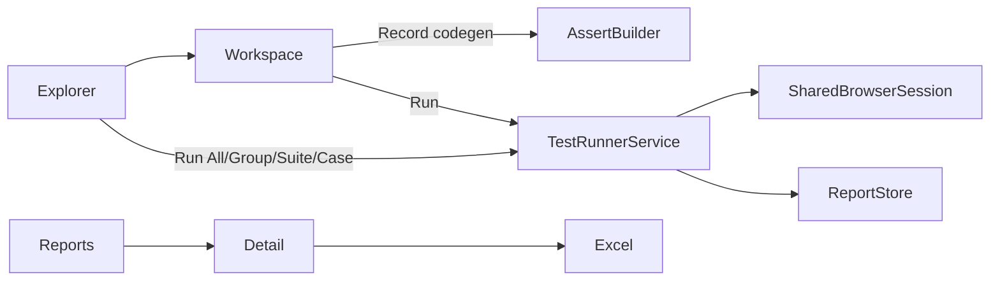

# Playwright Automation Studio — Plan (đồng bộ codebase)

Cập nhật sau khi audit code (2026-07-25). Plan cũ mô tả thiết kế; document này phản ánh **những gì đã có trên disk** và **gap còn lại**.

Tham chiếu kiến trúc đã ghi: [docs/ARCHITECTURE.md](docs/ARCHITECTURE.md), [docs/RELEASE_NOTES.md](docs/RELEASE_NOTES.md), [docs/BUILD.md](docs/BUILD.md).

---

## Trạng thái tổng quan

| Hạng mục | Status |
|----------|--------|
| Maven + Java 26 + JavaFX 26.0.1 FXML + Playwright 1.61 + POI 5.5.1 + Jackson 2.18.2 | **DONE** |
| Cây Group → Suite → Case, CRUD, Copy Suite/Case, drag-drop | **DONE** |
| Suite/Assert status DRAFT\|ACTIVE\|INACTIVE; Case Draft\|Ready | **DONE** |
| Record codegen → mở Assert Builder | **DONE** |
| Run ALL / GROUP / SUITE / CASE + skipReason | **DONE** |
| Soft-assert (assert fail → case FAILED; dual-check assertResults) | **DONE** |
| Share browser context (default ON multi-case) | **DONE** |
| Stop-on-first-failure (default OFF) | **DONE** |
| Browser combo + BrowserDetector | **DONE** |
| ToastService | **DONE** |
| Reports + Detail + Excel 3 sheets | **DONE** |
| Screenshot on pass/fail | **DONE** |
| APP_HOME `data/` + `work/` | **DONE** (dirs empty placeholders) |
| GitHub Actions ci.yml + release-portable.yml | **DONE** |
| Portable scripts (Node + Chromium + jar + run.sh) | **DONE** (nhưng launcher cần `java` hệ thống) |
| jlink/jpackage nhúng JRE (client zero-install JDK) | **GAP** |
| Sample project trong `data/project` | **GAP** |
| `.ai-context.md` | **GAP** |
| Automated tests (`src/test`) | **GAP** |
| AI sinh case | **OUT** (không làm) |
| Many-to-many shared case library | **OUT** (dùng Copy) |
| Embed browser / video | **OUT** |
| E2E GUI trên Actions | **OUT** |

---

## Stack thực tế ([pom.xml](pom.xml))

```text
Java release 26
javafx-controls / javafx-fxml 26.0.1
playwright 1.61.0
poi-ooxml 5.5.1
jackson-databind 2.18.2
javafx-maven-plugin 0.0.8
mainClass: com.studio.App
module-info.java: module com.studio.studio
```

**Không còn** class `PlaywrightService` — Record gọi codegen từ `SuiteWorkspacePageController`; Run dùng `SharedBrowserSession` + `StudioRuntime` + `TestRunnerService` (in-process compile/`URLClassLoader`).

---

## Cấu trúc repo (as-built)

```text
APP_HOME/
├── pom.xml
├── data/{config,project,reports,exports}/   # .gitkeep only hôm nay
├── work/                                    # .gitkeep
├── scripts/build-portable.sh|.bat
├── .github/workflows/ci.yml
├── .github/workflows/release-portable.yml
├── docs/ARCHITECTURE.md, BUILD.md, RELEASE_NOTES.md, ...
├── src/main/java/com/studio/
│   ├── App.java
│   ├── module-info.java
│   ├── model/   TestGroup, TestSuite, TestCase, Assertion,
│   │            CaseResult, AssertResult, RunReport
│   ├── store/   ProjectStore, ReportStore, SettingsStore
│   ├── service/ TestRunnerService, SharedBrowserSession,
│   │            AssertCodeGenerator, ScriptHarnessTransformer,
│   │            ScreenshotService, ExcelReportService, ToastService
│   ├── controller/ MainShell, Explorer, SuiteWorkspace,
│   │               AssertBuilderPopup, Reports, ReportDetail, ViewNavigator
│   ├── runtime/StudioRuntime.java
│   └── util/StudioPaths, BrowserDetector, StringEscapeUtil
└── src/main/resources/
    ├── fxml/*.fxml (6 files)
    └── css/studio.css
```

---

## Quyết định đã chốt (khớp code)

### Hierarchy & persistence

- Cây: **Group** (lồng nhau) → **Suite** → **Case**.
- Filesystem: `data/project/<Group>/.../suite.json` + `*.java`.
- **Assertions thuộc Suite** (`TestSuite.assertions[]`), không gắn từng Case. Khi Run một Ready case, soft-assert inject **toàn bộ assert ACTIVE của suite**.
- Suite status: `DRAFT` | `ACTIVE` | `INACTIVE`.
- Case status: `Draft` | `Ready`.
- Assert status: `DRAFT` | `ACTIVE` | `INACTIVE` — chỉ ACTIVE chạy.

### UI

- FXML: `main_shell`, `explorer_page`, `suite_workspace_page`, `assert_builder_popup`, `reports_page`, `report_detail_page`.
- Explorer: tree CRUD, copy suite/case, drag-drop reorder, status filter, **Preview panel** bên phải (không có `SuitePreviewDialog` riêng).
- Workspace: browser combo, headless, stop-on-first-failure, share context, Record, Run Case/Suite, code editor, assert list, terminal.
- Toast mọi action qua `ToastService`.

### Record / Run

- Record: Playwright codegen (Node); browser theo combo; xong → `openAssertBuilder()`.
- Run scopes: ALL / GROUP / SUITE / CASE.
- Collect + skipReason (as in `ProjectStore`): suite not ACTIVE; suite no active asserts; case Draft; (logic “no active asserts on case” hiện = suite không có ACTIVE assert — vì assert là suite-level).
- Soft-assert: chạy hết assert ACTIVE; cuối throw nếu có fail; runner đọc assertResults → **FAILED dù exit 0**.
- Share context: multi-case + checkbox → một `SharedBrowserSession`; case đơn / share off → session per case.
- Stop-on-first-failure default false.

### Browser

- `BrowserDetector` + combo: Chromium / Firefox / WebKit / Chrome / Edge (cái detect được).
- Default Chromium; lưu `SettingsStore`.

### Reports

- `data/reports/<runId>/report.json` + screenshots.
- UI list + detail; Excel Summary / Cases / Asserts.

### Portable & CI

- **CI:** `mvn -B -DskipTests package` trên PR/push.
- **Release:** matrix OS → `build-portable` → upload zip.
- **Portable hiện tại:** bundle app JAR + Node 20.18 + playwright-cli + Chromium + `data/` + `run.sh` gọi **`java -jar`**.
  - README nói “no JDK required” nhưng launcher **vẫn cần Java trên PATH** → **GAP** so với mục tiêu zero-install; cần bổ sung jlink/jpackage runtime image.

---

## Luồng chính (as-built)



---

## Việc còn lại (actionable)

1. **Portable JRE:** đổi `build-portable` sang `jpackage --type app-image` (hoặc jlink + wrapper) để client không cần cài JDK; cập nhật README cho khớp.
2. **Sample data:** tạo `data/project` mẫu (1 group + 1 suite ACTIVE + 1 case Ready) để onboarding.
3. **`.ai-context.md`:** sync architectural state theo rule dự án.
4. **Verify:** `mvn -q package` + `mvn javafx:run` smoke trên máy dev; ghi kết quả.
5. **(Optional)** Assert theo Case nếu product muốn khác model suite-level hiện tại.
6. **(Optional)** Unit tests cho `ProjectStore.collectCasesForScope`, `AssertCodeGenerator`, dual-check FAILED.

---

## Phạm vi không làm (giữ nguyên)

- AI sinh bước test
- Thư viện case many-to-many (dùng **Copy**)
- Embed browser trong JavaFX; video recording
- Email SMTP report
- Persist trạng thái ẩn panel
- E2E GUI test trên GitHub Actions
- Cross-compile một OS ra cả 3 (dùng CI matrix)

---

## Ghi chú lệch plan cũ → code

| Plan cũ | Code thực tế |
|---------|----------------|
| `PlaywrightService.java` | Không có; Record trong Workspace controller |
| Assert trên từng TestCase | Assert trên **Suite** |
| `SuitePreviewDialog` / `suite_preview.fxml` | Preview **panel** trong Explorer |
| Portable = jpackage app-image đủ JRE | Portable = JAR + Node + browsers; **cần java host** |
| UI code-only (docs guide gốc) | **FXML** (đúng quyết định sau) |
| Todos toàn `pending` | Core **completed**; gap portable-JRE / sample / verify |
